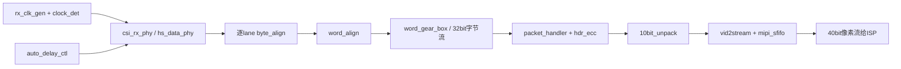
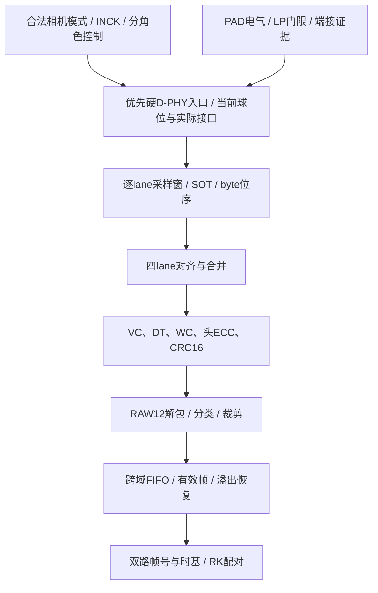

# PH1P100 接收模块复用核验（第三批第二小步）

> **2026-10-10更新：PCIe用户报告连接成功。官方系列页/新发布报道存在硬D-PHY信息，撤回此前直接排除硬核的执行前提；同一官网PH1P100SBG484选型行仍列MIPI DPHY为“－”，具体封装适配属于资料冲突，优先核对硬D-PHY入口，HRIO转为备选。详情见`docs/进度与D-PHY纠正记录_2026-10-10.md`；不能写成当前板硬核已经编译/上板验证。**

> 2026-10-09。按实际调用链审查17个明文文件和官方PH1P数字模板。本轮为静态源码核验，无仿真、综合/PnR或实测。不能把“明文可读”写成“可直接部署”。

## 1. 来源与调用链

R目录：`D:\TD\03_MLK_AFH03_AFC03\板卡资料\03_course\07_异构方案\AFC03_IMX415_PCIE_X1\AFC03_IMX415_PCIE_X1\IMX415_PCIE_X1\uisrc\03_ip\mipi_csi_2\`。

下文 `R/文件:行` 均指上述目录的本地现有版本。源平台含PH1A/PH2/DR1/Xilinx残留；版权/本地修改状态需保留，源码存在不自动给予任意再发布许可。

官方H：`D:\downlaod\ip\depot\HSIOF6F1DXP0_1.0\PH1P_HSIO\RTL\High_Speed_IO.v`。器件、电气、封装边界沿用 `PH1P100_接收路线证据.md`，本次直接复读H:357—387、726—743。

实际顶层 `R/mipi_csi_rx.v:89—184`：

这是旧参考链路图。当前首版必须把底层改为PH1P，将解包改为RAW12，并在包层加入DT分类、CRC及错误元数据；不能只替换一个原语名称。

## 2. 可以直接参考的独立思路

“直接参考”指借鉴算法与接口思路，部署仍需仿真及当前器件检查。

| 模块 | 可借鉴部分 | 仍需确认 |
|---|---|---|
| `csi_rx_hdr_ecc.v:17—29` | 24bit头计算6bit ECC的组合逻辑 | 用独立向量/错误注入核对；目前只是计算器，不是纠错器 |
| `csi_rx_byte_align.v:12、65—128` | 跨相邻采样字搜索0xB8、保存bit offset、重组字节 | PH1P SERDES输出先后顺序/位序、SOT前导条件、丢同步恢复与误匹配；增加LP/HS状态门控 |
| `csi_rx_word_align.v:33—58、88—155` | 逐lane历史字节与到达偏移匹配 | 历史范围至5个byte周期，没有无限deskew能力；范围外要报错，不静默锁定 |
| `csi_rx_word_gear_box.v:13—53` | lane字节合并为32bit包流 | 无valid即清空buffer/count；检查短包、非4整除WC、尾字节、包间隔和lane顺序 |
| `sfifo.v:202—215、240—318` | 指针Gray编码、双级跨域、异步置位/本域释放复位的结构 | RAM推断、满空边界、CDC约束、停钟恢复；不能由结构存在推断已经通过CDC/PnR |

## 3. 必须修改或重新适配

| 模块 | 代码事实 | 当前PH1P方案 |
|---|---|---|
| `rx_clk_gen.v:152—178` | PH1A分支用两套PH1_PHY_LCLK_V2 | 用官方H的PH1P_PHY_IOCLK串行采样+分频PH1P_PHY_LCLK并行时钟结构；PAD入口、精确球位、相位与STA另验 |
| `csi_rx_hs_data_phy.v:27—63` | PH1A使用5bit in_dly、IDDRx2再拼字节；其他分支落到PH2 HP_ISERDES | PH1P HR的8bit动态delay/HR ISERDES；禁止仅把DEVICE字符串改成PH1P后走默认PH2分支 |
| `csi_rx_phy.v:130—168` | 所有lane共享同一个6bit w_lane_delay_value | 改成逐lane8bit控制/记录；位序、训练和复位独立核对。参考顶层无LP端口（30—40行），需设计HS/LP识别与端接管理接口 |
| `auto_delay_ctl.v:28、51、79、113、160` | 6bit输出，扫描0..63，初值32 | PH1A适配实际仅取[4:0]（hs_data_phy:38），64次扫描在该分支重复32个物理值；不能沿用到PH1P的256 step |
| 同上 `:129—136、176—187` | 得分仅按所有lane对齐valid周期数；没有CRC/像素误码判定；best_len=0仍选32并报done | done与pass分开；每lane扫描采样窗，加入正确包/CRC/错误率及重复启停统计。对齐成功不等于无误码；6bit长度还不能表示64个连续通过点 |
| `csi_rx_clock_det.v:37—50、57—90` | 直接采样外部时钟电平判断跳变，并把外部域2bit计数直接在参考域比较 | 需重做停钟检测/复位释放协议。直接采样高速时钟可能混叠，多位计数直接跨域不安全；不能当作可靠停钟检测证明 |
| `csi_rx_packet_handler.v:74—115` | ECC严格比较、VC过滤、允许大量DT | 可以参考头字段拆解，但应显式输出VC/DT/WC/错误状态；不把所有长包送进像素解包 |
| `csi_rx_vid2stream.v:58—61、159—180` | tvalid依赖tready；使用42bit、地址13bit的FIFO；full/afull未反馈到包层 | 改成valid独立于ready、停顿期间数据/sideband稳定的流接口；溢出计数并使整帧失效。MIPI源不能靠下游ready反压暂停 |
| `sfifo.v:99—100` | FIFO满时抑制写入 | 满时丢弃是现有行为；上层未建立“丢整帧→下个FS重新同步”的恢复策略，必须补齐 |
| `mipi_csi_rx.v:159—184` | 固定调用RAW10解包并输出4×10bit像素 | 改为RAW12路径，包尾byte有效数、样本有效数、帧/行/错误sideband一并改。避免RAW12仅截断后冒充RAW10的5字节协议 |

1:8 pclk在594/720/891 Mbps下分别为74.25/90/111.375 MHz；这些是候选结构的算术结果，无当前球位映射证据。

## 4. 确认缺失的关键功能

1. **RAW12解包。** `csi_rx_10bit_unpack.v:34—41`明确按5 B→4个10bit样本拆分；首版需要按RAW12的3 B→2个12bit样本处理，并适配4 B拍输入的跨拍残留。17文件没有RAW12模块。
2. **CSI负载CRC16校验。** 包处理代码按WC累计到结束（packet_handler:135—188、191—219），未见CRC多项式/状态累加/footer比较；全17文件关键词与代码核对也未找到负载CRC实现。必须消费并验证footer，和未来PCIe帧CRC分开。
3. **DT分流及记录区裁剪。** packet_handler:91—104允许EBD(0x12)、OB(0x37)、RAW10/12等；191—219对长包统一输出payload，248—251统一产生line开始脉冲。顶层没有按DT过滤再解包。需要隔离EBD/OB，按模式去除边缘/dummy，维护1920×1080记录区。
4. **头ECC错误分类。** 现有比较能拒绝不一致的头，未实现单bit纠错/双bit检测分类；头错误总数、纠正数/不可纠正数、失步恢复均未对外提供。首版可以明确采用“检测后丢弃”策略，但不能称为ECC纠错已具备。
5. **包尾/短负载有效字节。** packet_handler:158将WC<4抬到4、177—178每次+4，无byte keep。末拍可能含非负载字节；完整4B边界也要验证状态切换是否多放行一拍。此处是需仿真的边界风险，尚无错误注入运行结果。
6. **完整帧诊断与恢复。** 对外缺WC/行数/像素数不符、CRC错、丢失FS/FE、SOT/deskew失败、FIFO满、截断包等累计计数及帧有效位。内部5bit timeout计数不能替代验收日志。
7. **双路配对元数据。** 每路独立frame_seq、camera_id、mode_id、共同时间基SOF辅助时间戳、错误状态；RK只有收到有效左右帧对才进入深度计算。不能按“两个最新到达帧”直接配对。

## 5. 未调用/不可读部分的边界

- `csi_rx_hs_clk_phy.v:12—25`是DR1原语残留，内部w_clk_hs_rx还未见驱动；实际顶层通过rx_clk_gen生成时钟，不能因为目录里存在这个文件就把它加入PH1P工程。
- `csi_rx_idelayctrl_gen.v:23—44`调用Xilinx IDELAYCTRL，不在上述实际主调用链；不能给PH1P增加Xilinx延时校准器。
- `wfifo.v`为另一份明文FIFO实现。本次只核对其接口、满写抑制、Gray CDC和RAM推断边界，未宣称全部976行通过功能验证；当前vid2stream实际调用sfifo而非wfifo。
- 另一路参考目录 `D:\TD\03_MLK_AFH03_AFC03\板卡资料\03_course\07_异构方案\415_mipi\uisrc\03_ip\al_ip\mipi_rx\`：`data_lane_rx_wrapper.enc.v:28`及`channel_aligner_wrapper.enc.sv:17`开始受保护正文。可读端口不等于能审查内部时序或移植原语；这些内部实现不列为已核实可复用项。

## 6. 首版接收的依赖与退出证据

进入图像链之前要提供：合法PnR/时序报告与源版本、重复启停的采样窗口、关键寄存器读回、连续帧尺寸/DT/WC统计、CRC/溢出/丢帧日志；**这些实验本轮尚未进行**。软件仿真至少覆盖bit offset 0..7、lane偏移0..5及超限、RAW12跨拍、WC mod4各种尾拍、坏ECC/CRC、EBD/OB、丢包/帧、FIFO满、下游停顿和复位停钟恢复。

本表已足以估算首版接收实施范围；PHY电气、精确时钟路由及实物同步仍按已有门槛处理，不继续无限翻旧板卡以替代实验。
