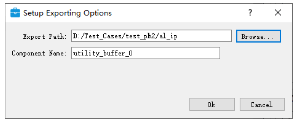

# RAW10 稳定档位：PLL 生成与接入交接

用户已批准：IMX415 全像素 RAW10、4 lane、891 Mbps/lane、27 MHz、30 fps；FPGA 960×540 灰度预览，HDMI 标准 1080p30。**10-10最新：PLL重新生成后配置已通过，稳定档位已接入，实施与验证结果见[本轮报告](RAW10稳定档位实施与验证_2026-10-10.md)。下文保留生成步骤供查阅。**

## 1. 本次要生成什么

在本机 TD 的 PLL IP 向导中，为 **PH1P100SBG484、speed -3** 生成新的时钟 IP。使用新名称 `raw10_clocks`，保存到：

```text
D:\TD\work\csi2\prj\camera_peer\uisrc\03_ip\raw10_clocks
```

打开的工程为 `D:\TD\work\csi2\prj\camera_peer\fpga_prj.al`；保留原 `ui_pll`，新 IP 生成后暂不手动改顶层或下载。

| 向导项目 | 目标 |
|---|---|
| 参考输入 | 板载 50.000 MHz |
| HDMI pixel 输出 | 74.250 MHz，0° |
| HDMI serial 输出 | 371.250 MHz，0°；与 pixel 同 PLL，5:1 |
| 相机 MCLK 输出 | 27.000 MHz；优先同一 PLL 的第三路，若向导不能同时满足，另外生成 `cam_mclk27` |
| 复位/锁定 | 启用 reset 和 lock 输出；其余动态调相/扩频不主动开启 |
| 频率精度 | 查看计算后的实际频率；不能只保存“请求频率”就判定达标 |

**2026-10-10补充核验：这组三路输出使用 `No compensation` + `VCO Fractional Enable` 的自动频率配置。** 本机向导计算代码已算出显示值 74.250000、371.250000、27.000000 MHz；默认 `Normal`/CLK0反馈则算成75、375、26.785714 MHz，不能直接沿用。该结果只验证计算配置，不等于已生成IP、通过PnR或上板。

生成完成后只需告知实际保存目录及向导结果。Codex 将读取生成文件、核对频率和时钟关系，并执行后续接入/仿真/TD CLI 构建。无需上传许可证或机器配置。

## 2. 打开已有工程

1. 启动本机 TangDynasty，使用当前 TD 6.2.2 / 2026.1 SP2。
2. 通过 **File → Open Project** 打开：

   ```text
   D:\TD\work\csi2\prj\camera_peer\fpga_prj.al
   ```

3. 检查器件为 **PH1P100SBG484**，速度等级为 **-3**。某些内部报告将等级显示成`3`，不要因此切换器件。保留当前顶层`f9p_imx415x2_top`。
4. 这一步只生成新IP，保留旧`ui_pll`。不需要接板、下载或先运行综合。

## 3. 进入PLL向导并填写保存位置

1. 点击菜单 **Tools → IP Catalog**。
2. 在目录中找 **Primitive IP → Clock → PLL**；若目录折叠，先展开Clock。也可以搜索`PLL`。本项目原PLL对应本机IP实现`PLLF6F1D0P0`、版本1.1；选择当前PH1P器件下的PLL，不选择HXT收发器PLL。
3. 双击PLL，出现 **Setup Exporting Options**。
4. 两栏分别填写：

   | 字段 | 填入 |
   |---|---|
   | `Export Path` | `D:\TD\work\csi2\prj\camera_peer\uisrc\03_ip` |
   | `Component Name` | `raw10_clocks` |

   **Export Path填父目录，不附加`raw10_clocks`。** 向导会按模块名自动建子目录，最终应为`03_ip\raw10_clocks\raw10_clocks.v`。若同名目录已经存在，先核对是否为这次生成结果，不选择覆盖旧IP。
5. 点击 **OK** 进入PLL参数页面。

下面是TD手册的保存窗口示例，仅用来辨认两栏；图中是BUFG示例，实际名称与路径按上表填写：



## 4. 填写Clock Options

切换到 **Clock Options** 页面，按下表填写。大小写及末位小数显示可能略有差异，字段名称来自本机PH1P PLL的`Layout.tcl`。

| 分组/字段 | 本次设置 | 作用 |
|---|---|---|
| `Input Frequency` | `50.000000` | 板载参考时钟 |
| 输入`Unit` | `MHz` | 不选ns |
| `Feedback Mode` | **`No compensation`** | 配合本次分数VCO配置 |
| `Feedback Clock` | 随模式自动设置/不可用时保持默认 | 不强行指定CLK0作外部反馈 |
| `Enable Reset` | 勾选 | 导出PLL复位端口 |
| `Enable PLL Lock` | 勾选 | 导出锁定状态 |
| `SSC Enable` | 不勾选 | 本次不用扩频 |
| `Enable Power Down` | 不勾选 | 本次不导出动态关断控制 |
| `Enable Clock Out Reset` | 不勾选 | 本次不增加各输出复位控制 |
| 动态粗调相、细调相、动态配置 | 不勾选 | 本次使用固定相位 |

`No compensation`是向导中的反馈模式名称，不表示取消设计的时序分析。PLL输出仍需经过真实时序约束、布线和硬件验证。

## 5. 填写Output Clocks

1. 切换到 **Output Clocks** 页面。
2. 将 **Configuration Mode** 设为 **Clock Frequency**，让向导自动计算分频；不要切到`Parameter Setting`手填倍频/分频系数。
3. 在 **Fractional Setting** 分组中，勾选 **VCO Fractional Enable**。若它是灰色，返回上一页检查`Feedback Mode`是否已改为`No compensation`。本机向导明确限制：VCO分数模式只能在该反馈模式开启。
4. **CLK0 Fractional Enable**保持不勾选。本方案使用VCO分数倍频和各输出整数分频，不另加CLK0分数分频。
5. 展开/滚动到CLK0、CLK1、CLK2，逐项设置：

   | 字段 | CLK0 | CLK1 | CLK2 |
   |---|---|---|---|
   | `CLKx Enable` | `ENABLE` | `ENABLE` | `ENABLE` |
   | `Frequency` | **74.250000** | **371.250000** | **27.000000** |
   | `Frequency Unit` | `MHz` | `MHz` | `MHz` |
   | `Phase Shift` | `0` | `0` | `0` |
   | `Phase Shift Unit` | `deg` | `deg` | `deg` |
   | `Duty Cycle`（请求值） | `50` | `50` | `50` |
   | `Use Bx clock` | 不勾选 | 不勾选 | 不勾选 |

6. CLK3及之后能看到的额外输出设为`DISABLE`，本次只开三路。
7. 各路`Buffer Type`先保持向导默认；生成后由Codex结合全局时钟/输出管脚接法核对。每路的 **`Enable Clock`复选框不是上表的输出开关**，它用于导出动态时钟使能端口；本次保持不勾选，输出是否存在由`CLKx Enable=ENABLE`决定。
8. 输入完最后一个数值后，点击其他字段或按Tab让向导重新计算，查看 **Actual Frequency**。
9. 如果有单独的 **BandWidth** 页面，本次`BandWidth Setting`保持 **Low**。本机计算得到VREF约16.667MHz，向导代码为该范围选择Low；不用手填电荷泵或环路滤波系数。

本次三路时钟分别用于HDMI像素、HDMI串行与相机MCLK。**不要把891或111.375填进这里**：891是相机lane数据率；111.375MHz字节时钟来自接收PHY对相机输入时钟的分频。

## 6. 生成前核对计算结果

预期可见：

| 检查项 | 应看到 |
|---|---|
| CLK0 `Actual Frequency` | 约`74.250000 MHz` |
| CLK1 `Actual Frequency` | 约`371.250000 MHz`，与CLK0保持5:1 |
| CLK2 `Actual Frequency` | 约`27.000000 MHz` |
| 三路相位 | 请求0°；核对实际相位，无异常提示 |
| 请求/实际占空比 | 请求50%；保留实际显示结果供核验 |
| 错误区域 | 没有非法VCO、参考频率、分频或带宽等错误 |

若有 **Summary** 页面，在这里再对照输入50MHz、三路实际输出和使能状态，然后生成。

本机向导计算函数在上述配置、`PH1P100SBG484/PLL_V1=1`下得到VCO约1485MHz，输出分频20、4、55。分数VCO的有限位宽产生极小量化偏差，界面六位小数显示为目标值；最后由生成RTL参数核对，不要求你手算或修改底层系数。

如果仍出现 **75/375/26.785714 MHz**，首先核对`No compensation`和`VCO Fractional Enable`；如果显示74或370等不同档位，也先停在向导，不用改目标数字迎合工具。若界面没有这些选项或有错误，保留当前页和提示，再一起核对，不反复切换器件。

## 7. 生成文件并保存工程

1. 确认参数后点击配置窗口的 **OK**。
2. 若随后弹出 **IP Generating Options**，优先保留`Behavior`源码生成选项与刚才的导出位置，点击 **Generate**。若该IP没有出现这一层弹窗，以实际成功生成提示和文件为准。
3. 等待生成完成，再保存工程。TD通常会把生成的IP加入工程源列表；如果只是生成了文件，暂时保留结果，后续由Codex核对加入方式。
4. 查看目录：

   ```text
   D:\TD\work\csi2\prj\camera_peer\uisrc\03_ip\raw10_clocks
   ```

   应有`raw10_clocks.v`以及相应`RTL`/XML等依赖文件。文件名称和数量以实际生成器为准，**保留整个IP目录**，不要只复制一个顶层`.v`。
5. 可打开`raw10_clocks.v`只读查看，预期导出参考输入、三路时钟、reset和lock；不手动改生成参数。若生成器只给一层IP描述/包装，保留完整文件供后续检查。
6. 本次不需要点击`Create RTL Wrapper`，不把自动包装设为工程顶层；现有顶层保持不变。不运行下载。

完成后告诉我“已生成”以及保存目录即可，我会直接读取。若失败，先给最关键的向导错误或`Actual Frequency`结果，一次处理一个问题。

## 8. 原文与计算证据

- `D:/downlaod/Doc/TD_User_Guide_V6.2.pdf`：物理PDF第47—49页、页脚46—48，给出Tools→IP Catalog、保存窗口、OK/Generate与自动加入工程流程；其BUFG及其他器件截图仅用于说明通用流程，不作为本板PLL验证。
- `D:/downlaod/ip/depot/PLLF6F1D0P0_1.1/Layout.tcl`：第9—15行输入频率，第25—35行反馈，第78—101行reset/lock，第108—130行配置模式/分数设置，第131行限定VCO fractional的反馈模式；第170行起CLK0字段，第339行起CLK2字段。
- 同目录`Dependency.tcl`：第1108行`Calc_Dividers`、第1585行`Calc_VCO_Fractional_auto`；PH1P100分数精度及实际频率计算来自这些代码。
- 项目原IP `fpga/csi2/prj/camera_peer/uisrc/03_ip/ui_pll/Design.xml`中的`PLL_V1=1`用于选择本机计算分支。
- 仅读取本机计算程序的复现脚本：[probe_raw10_pll_calc.tcl](../tools/td/probe_raw10_pll_calc.tcl)；保存的[计算输出](evidence/raw10_pll_wizard_calc.log)。NOCOMP/分数模式通过三路目标频率检查及向导`set_error_disp`参数检查。此脚本不生成IP、不开工程、不修改安装目录，也不是正式PLL综合或仿真。

## 9. 为什么仍需要向导生成

本机 `td_commands_prompt.exe` 是 TD 6.2.2.200067 / 2026.1 SP2。实际命令注册检查中，`create_ip`、`get_ips`、`get_ipdefs`、`generate_target`、`load_project_ips` 均不存在；工程内旧 `gen_ip.tcl` 不能作为当前有效入口。`xmlipgen` 与 `ipgen_synip` 名称存在，但 `-help` 未返回可用参数说明或生成文件。`IpTool.exe -help` 也没有产生可验证的生成结果。

这只说明当前尚未找到有效的自动生成方法，**不证明 TD 永远不能从 CLI 生成 PLL**。现有综合、PnR、STA CLI 已实际可用；本次修复后的完整布线报告保存在仓库。若后续取得原厂命令说明或向导导出的脚本，可恢复自动生成。

探索原始记录：本项目 `tmp/probe_ip_cli.log`、`tmp/probe_xmlipgen.log`、`tmp/probe_project_ip_cli.log`。最后一个探查曾从仓库目录打开 D 盘工程，触发相对源路径分析错误，该日志不是构建证据；工程 `.al` 已恢复到已提交且有效的副本并核对 SHA256。正式构建始终应切换到 D 盘相机工程目录再执行。

## 拿到 PLL 后的接入检查单

1. 检查新生成 RTL 参数、依赖、输出端口及实际计算频率；同步工程快照，保留原 IP。
2. 按 Sony E19505D2X 第 55、80 页完整设置 RAW10 全像素 / 891 / 27 档，包括 BCWAIT=0x005D、CPWAIT=0x0042、SYS_MODE=5、INCKSEL3=0x00C6、INCKSEL4=0x00E7、TXCLKESC_FREQ=0x06C0、INCKSEL6=0、INCKSEL7=1，以及 VMAX/HMAX、global timing。**300B应保持0xA0：第34页规定bit5/bit7固定为1，CPWAIT高字段为0不代表整字节清零。**
3. 以新 PLL lock 和同步复位控制 MCLK/相机释放；补启动等待与错误处理，不让“寄存器写完”代替成功读回。
4. HDMI VTC 改为总计 2200×1125，保持 1920×1080 有效区及配套同步；RAW10 lane clock 445.5 MHz、byte clock 111.375 MHz 的约束须与已实现模式一致。
5. 运行时钟/模式与视频时序测试，再综合、PnR、STA。通过前不生成用于验收的 bit。
6. 继续本板 DDR 初始化、原生 PAXI、FIFO 和灰度三槽帧管理，随后准备指定版本上板。DDR 地址/握手契约尚需从实际控制器确认。

相关源码、已通过的测试、失败时序和 DDR 设计见 [RAW10 灰度与 DDR 推进记录](RAW10灰度显示与DDR推进记录_2026-10-10.md)。RAW12 封存模块保持不变。
