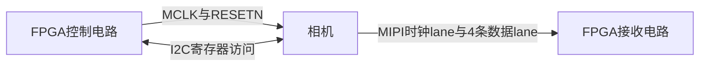

# FPGA主线学习手册：从一只相机到双目系统

> **2026-10-13 执行入口：** 当前状态以[交接摘要](../CODEX_HANDOFF.md)和[同程序诊断报告](../docs/HDMI同程序负载保留对照_操作与证据_2026-10-13.md)为准。诊断仿真通过、最终STA失败、无新bit；继续保留222159。下方10-10的30Hz及DDR未接入描述为历史状态，不恢复执行。

> **2026-10-10 当前主线：RAW10 灰度显示与 DDR。** 用户确认先修复错位并完成灰度显示/DDR闭环；RAW12封存在独立解包模块仿真和综合通过状态，不再推进相机接入。RAW10数学、行帧/像素对齐、HDMI包装边界测试通过；新TD布线完成但setup WNS=-0.515ns、28个违例端点，STA失败，未生成新bit或下载。用户已批准下一档位：4K30 RAW10 / 891Mbps/lane / 27MHz，继续960×540灰度预览、标准1080p30 HDMI；尚未改寄存器/PLL或实测。DDR已定位本板示例及原生PAXI接口，尚未接顶层。下一步落实配套时钟/模式，再移植DDR初始化、帧队列及FIFO。详见`docs/RAW10灰度显示与DDR推进记录_2026-10-10.md`。本条覆盖下方历史RAW12路线；用户报告出流/PCIe成功不等于CRC、DMA和显示验收。

> 版本：2026-10-09。供本项目接手者阅读，沿用已经确认的硬件、架构和D1/D2实操基础。本文件讲原理、数据流与调试思路；配套的`02_FPGA独立开发路线与工作包.md`讲怎样落实。
> 当前状态：相机/子卡尚未接好；相机控制和接收最小工程尚未实现。官方套餐与客服背书按用户提供的板级组合使用依据接受，接下来直接进入相机主线，不等RK，也不先安排独立仪器排查。
> **2026-10-10专项核验更新：PCIe用户已报告连接成功。本板8个ZIP/57个.al条目及相关原始资料中未找到PH1P100SBG484硬D-PHY例程；精确型号手册、TD资源表及MIPI IO支持名单共同指向本型号未列专用硬D-PHY。系列/新闻概述仍待原厂解释，不按两组已确认硬核排工程。F0—F2继续，F3落实官方匹配接收工程及当前器件可支持的前端，不无限等待硬核入口。完整定位见`docs/F9P_PH1P100_硬D-PHY例程专项核验_2026-10-10.md`；本轮无新工程/接收实测。**

## 阅读方法

第一次读第1—5章，先知道“谁控制谁、数据从哪里来”。第二次读第6—10章，知道怎样从字节得到可靠图像。第三次读第11—15章，把图像处理、压缩、DDR、PCIe和双目放回整条链。最后用第16章自查，第17章查原文。

不要求先背寄存器、读完所有官方课程或通读全部参考代码。遇到一个模块，先弄清它的输入、输出和可观察结果，再学该模块需要的细节。你已经会TD下载、用ChipWatcher抓波形，也跑过HDMI/DDR官方bit，这些基础直接沿用。

文中标记：**已确认**指用户决策或有当前器件原文依据；**设计候选**指准备实施的工程选择；**已有实操**指用户报告或已留证结果；**待验证**指尚无本项目工具/硬件结果。它们回答不同的问题。

## 1. 我们最终在做什么

我们在做一套双目视觉系统。两只相机采集左右图像，FPGA负责稳定接收、硬件预处理、压缩、缓存和发送，RK负责接收解码、彩色图恢复、标定校正、匹配深度及NPU推理。

最终需要交付真实图像、真实算法结果和量化报告。双路1080p30是首个完整采集目标；深度可以先用较低分辨率/帧率，按RK实测确定。4K是有余量后的升级，赛题场景中的60fps也要另行比较，不能用开发目标代替最终指标。[S1]

当前先完成其中可由你独立推进的一段：


先争取一只相机正确出图，再扩展双路。PCIe已经由用户报告连接成功；后续沿用该基础推进实际数据搬运与联调，不再把RK未就绪/PCIe未连接当当前阻塞。相机控制、接收、算法和本地缓存仍可独立推进。

### 1.1 你手上的设备各做什么

| 设备 | 在项目中的作用 | 当前边界 |
|---|---|---|
| F9P/PH1P100 | 运行你编写的硬件电路 | 器件选PH1P100SBG484、speed -3 |
| VID006 | 把两路相机连接到FEP，并提供板级供电/信号路径 | 双4lane，控制IO为1.8V；不是现成CSI解码器 |
| CAM005/IMX415 | 把光转换成Bayer样本，按配置输出CSI数据 | 需时钟、复位和寄存器配置 |
| PC与TD | 编写/仿真/实现/下载，查看调试信号 | PC暂时也可辅助检查抓取样本 |
| OrangePi 5 Max/RK3588 | 接收FPGA数据，完成软件视觉和NPU | 新增ISP/深度交付仍待队友接受 |
| HDMI显示器/调试导出 | 将本地数据变成可检查的结果 | 是调试出口，当前工程尚未集成 |

VID006和相机属于官方套餐，这使我们有依据直接使用这套组合。接收是否稳定、同步误差和持续吞吐则会在研发中获得实际结果，不需要先把所有未知都研究完才开始。

## 2. FPGA为什么不能按“逐行执行程序”理解

CPU通常通过指令依次完成计算。Verilog描述的是电路：计数器、寄存器、加法器、FIFO和状态机在时钟下共同工作。一个模块接收当前像素时，后面的模块可能正在处理前一个像素，DDR也可能正在发送更早的一帧。

因此，写FPGA代码时最常问的不是“这行先执行还是后执行”，而是：

- 数据在哪个时钟沿进入寄存器？
- 这拍的数据是否有效，和它对应的帧号/行号是否一起延迟？
- 下游暂时不接收时，上游会停住、缓存还是丢数据？
- 两个模块的时钟不同，怎样安全交接？

### 2.1 一条最简单的流水线

假设灰度模块有三级：取RGB、加权求和、舍入输出。第3拍输出第1个像素时，第2级可以处理第2个像素，第1级同时接收第3个像素。

**延迟**是某个像素从输入到输出用了多少时间；**吞吐**是持续运行时每秒能处理多少像素。流水级变多可能增加延迟，同时帮助提高可实现频率。不能只看“用了几级”判断系统快慢。

### 2.2 为什么仿真、综合、布局布线、上板都需要

| 阶段 | 回答的问题 | 仍不能回答什么 |
|---|---|---|
| RTL仿真 | 状态机、位序、算法和异常行为是否符合设计 | 真实PAD波形与实际布线效果 |
| 综合 | 电路能否转换为当前器件逻辑，资源大致多少 | 所有时钟和IO是否能合法连接 |
| 布局布线/STA | 球位、时钟资源和时序是否满足当前约束 | 相机真实数据是否正确 |
| 上板 | 这个实现与实物一起运行的结果 | 未执行场景的长期稳定性 |

我们按小模块循环这些步骤。不会先写完整套系统再首次上板，也不会用跨平台参考的报告充当当前板报告。

### 2.3 遇到缩写先看这里

| 缩写 | 在本文中的直观含义 |
|---|---|
| RTL | 用Verilog等描述寄存器与组合逻辑的电路层次 |
| PLL | 用于生成所需频率/相位的时钟资源；lock是其锁定状态 |
| PnR / STA | 布局布线 / 静态时序分析，检查电路放置连接及时间约束 |
| FIFO | 先进先出的短数据队列，适合缓冲及跨域交接 |
| CDC | 不同时钟域之间的数据/控制交接问题 |
| HS / LP | MIPI高速传输状态 / 低功耗信号状态，电平与用途不同 |
| SOT | 高速传输开始时用于同步识别的序列/过程 |
| SERDES | 串行与并行数据转换器；本项目接收侧主要是串转并 |
| keep | 并行字节流中“哪些字节有效”的掩码 |
| ECC / CRC | 按协议计算的校验信息，用于检查包头或数据错误 |
| LUT / CDF | 本文均衡算法中的查找表 / 累积分布；这里的LUT不是FPGA逻辑单元计数 |
| TLP / DMA | PCIe事务层数据包 / 设备与主机内存之间的数据搬运机制 |

这些名词不需要一次记住，用到哪一层就回看对应解释。

## 3. 先把两条不同的路线分开

相机连接到FPGA后，同时存在**控制路线**和**图像数据路线**。



控制路线回答“让相机以什么方式工作”：MCLK、复位、I2C、模式、曝光、增益。数据路线回答“怎样把相机已经输出的数据还原成图像”：采样、对齐、CSI解析、RAW解包、裁剪和帧检查。

**I2C成功不等于图像接收成功。** 它证明通信和部分控制链路成立。反过来，看到MIPI跳变也不等于能得到有效像素，跳变还要经过协议解析与校验。[C1][R1]

## 4. 相机怎样从上电走到输出图像

你不需要先把Sony全部寄存器背下来，先记住四件事：相机需要正确供电、解除复位、获得输入时钟、收到配置。

### 4.1 MCLK是什么

MCLK是FPGA送给相机的参考时钟，Sony称INCK。当前首次接收候选采用27MHz。相机内部利用它和配置参数生成自己的读出及输出节奏。

它和相机返回的MIPI时钟lane不是同一根线，也不是同一频率：前者由FPGA提供，后者由相机提供、供接收端采样高速数据。不能拿50MHz系统时钟或随意整数分频去替代已经选定模式所需的27MHz。[C1]

### 4.2 复位和启动等待是什么

Sony手册85页要求电源稳定后保持XCLR低至少500ns，释放后到INCK至少1µs，到寄存器通信至少20µs。模组内部电源由模组处理；FPGA控制的是引出的复位、时钟和通信，不能虚构自己控制了模组内部三路电源。[C1]

读取默认寄存器是第一项有明确答案的调试：33页列3000h STANDBY与3002h XMSTA复位默认整字节均为01h。它们是状态/控制寄存器，不能称为芯片ID。

正式启动图像时，先在待机中配置，写STANDBY=0成功后等待至少24ms，再启动主机XMSTA=0。这个等待应由持续运行的控制时钟计数；此时MIPI时钟还可能未出现，不能依赖MIPI域计时。前8帧属于初始化阶段，从第9帧开始评价正常图像。[C1，85、89页]

### 4.3 I2C在这里做什么

一次寄存器访问会包含设备地址、寄存器地址和数据。设备地址表示“和哪只器件说话”；16bit寄存器地址表示“访问器件内部哪一项”。SDA在读写方向间切换，ACK由接收方应答。

参考配置源码中的CAM_ID为8'h34；这类8bit写地址表示法与7bit地址表示法不同，不能把34h不加说明地交给采用7bit地址的接口。最终实现还要核对模组地址选择及读事务的重复起始/ACK时序。[C2，ui_cfg_imx415.v:49]

首次控制模块至少输出：当前状态、访问地址、ACK/NACK、超时、读回数据、完成标志。看到busy结束只能说明状态机结束，必须同时检查错误和读回值。

旧参考存在“错误信号未用于阻止继续配置”“3000/3002连续写而无独立24ms等待”等差异。我们保留其寄存器访问思路，按新核验修正，不能复制整个参考就宣布当前板配置完成。[C2]

## 5. 1080p、fps、bit和lane分别是什么

| 名词 | 意思 | 本项目例子 |
|---|---|---|
| 分辨率 | 每帧有效记录区的宽×高 | 1920×1080=2,073,600个样本位置 |
| fps | 每秒图像帧数 | 首次候选20fps，后续目标每路30fps |
| ADC位宽 | 光电信号数字化的量化位数 | 此binning模式为10bit ADC |
| RAW输出位宽 | CSI线上一个样本采用的格式 | 同一模式输出RAW12 |
| lane数 | 并行传送高速数据的通道数 | 每相机4条数据lane，另有时钟lane |
| lane速率 | 每条数据lane的串行比特率 | 首次候选594Mbps/lane |

**10bit ADC和RAW12可以同时成立。** Sony的对应binning模式表就是这样定义的。接收端必须按线上RAW12拆包，不能因为ADC是10bit而套RAW10的5字节解包器。[C1，59—61页]

首次候选：1920×1080、H/V 2/2-line binning、RAW12、4lane、594Mbps/lane、INCK 27MHz、HMAX=1650、VMAX=2250、20fps。HMAX/VMAX控制行/帧周期，不能把它们直接当有效图像的宽高。

后续30fps比较594Mbps的推导配置与Sony表列891Mbps配置。首次用20fps是为了更早验证正确接收，不是修改双路1080p30最终开发目标。[C1]

## 6. 高速串行信号怎样进入普通RTL

一条594Mbps lane每秒有5.94亿个比特。不能把它直接送给50MHz普通always块，期待逐bit读取。输入前端要使用专用IO、采样时钟、串并转换和输入延时资源。

### 6.1 当前PH1P100上的接收路线

2026-10-10进一步查本板8个ZIP、VID006原包、精确型号手册与TD资源后，**没有找到PH1P100SBG484硬D-PHY例程或匹配支持证据**。具体技术资料共同指向本型号未列可用专用硬D-PHY。系列/新闻描述与其口径仍有差异，但不能把“两组可用硬核”作为当前工程前提。优先取得官方套餐匹配接收工程，HRIO/over-LVDS参考保留候选；不让寻找硬核阻塞连接、I2C和相机配置。详见`docs/F9P_PH1P100_硬D-PHY例程专项核验_2026-10-10.md`。[H0]

硬D-PHY是真实存在的一类专用资源，本机PH1P模板也确有调用；其支持名单包含PH1P35等型号，未包含当前SBG484。若官方提供当前型号的新支持，按实际IP边界重新核对；否则接收方案须落实普通IO的采样/时钟/解串与LP/HS实现。CSI包校验、RAW12解包都按实际模块边界核对。

参考工程中有PH1A、PH2或DR1原语，不能只把器件名替换后就当移植结束。尤其是delay位宽、时钟路径、采样并行宽度和输入复位行为必须匹配PH1P。[R1]

### 6.2 1:8串并转换的直观含义

本节和6.3是原HRIO备选结构的学习例子，不再作为硬D-PHY必需的参数/调试步骤。硬D-PHY输出宽度、时钟及训练方式以新资源为准。

一次收8bit，串行速率594Mbps对应每lane输出8bit字节的节奏74.25MHz。4lane合并后，一拍最多得到4字节，即32bit；这不等于每拍4个RAW12像素。

候选DDR结构中高速采样时钟sclk=594/2=297MHz，并行pclk=594/8=74.25MHz。891Mbps时pclk=111.375MHz。这些是结构推导值，实际可用时钟及球位路径要看本工程PnR/STA。[H1]

### 6.3 delay究竟调整什么

采样沿应落在数据稳定区域。输入delay微调数据到采样器的时间，使采样位置远离跳变边缘。当前HR输入delay是8bit、256 step，旧参考6bit扫描及PH1A只取5bit的写法不能照搬。[H1][R1]

训练要观察一段范围内的可靠结果，不能找到一次字节同步就称为稳定。后续结合SOT、包/CRC错误和重复启停结果评估窗口，具体tap由实测决定。

### 6.4 这阶段ChipWatcher看什么

先看PLL/复位/接收活动，再看各lane并行字节、对齐状态和错误计数。ChipWatcher通常看到的是转换后的并行数据及内部状态，不能代替示波器直接证明高速PAD共模和摆幅。

遇到具体异常，再决定是否需要仪器或厂家参数。我们不在开始接线前安排一套完整的高速测量任务。

## 7. 为什么得到字节之后还不能当像素

CSI-2像一套有结构的运输包装。接收流包含包头、图像负载、校验以及不同类别的数据。直接把所有字节画出来，就会把包头或嵌入数据画成噪声。

### 7.1 需要认识的包信息

| 内容 | 用途 | 对本项目的影响 |
|---|---|---|
| FS/FE短包 | 帧开始/结束 | 建立帧边界，统计缺帧/缺结束 |
| VC | 虚拟通道标识 | 按配置接收对应通道 |
| DT | 数据类型 | RAW12=2Ch，EBD=12h，OB=37h |
| WC | 长包负载字节数 | 决定消费多少字节，处理末拍有效字节 |
| 头ECC | 包头完整性 | 头错不能继续相信错误长度 |
| 负载CRC16 | 长包数据完整性 | 出错时使相应帧无效并计数 |

Sony50—52页显示帧中有Embedded Data和OB等内容。因此不能把“一个长包”一概理解成“有效图像的一行”。我们要先按DT分流，再按模式处理记录区、边缘和裁剪。[C1]

目标裁剪后1920像素RAW12每行2880B，但线上包可能还包括模式规定的边缘等数据。**2880B是最终记录区长度，不能未经实流核对就当所有图像长包的WC。**

### 7.2 四lane为什么需要对齐

每lane独立采样得到字节，但字节边界和lane之间的到达时刻可能不同。需要先完成位/字节同步，再按相同的包位置合并lane。否则四个字节各自看起来在变化，拼起来的包头却一直不合法。

旧明文参考可提供组织方式，但缺RAW12路径、负载CRC16、完整尾拍有效掩码和可靠溢出恢复，部分valid/ready行为也需要改。因此17个文件是参考起点，不是已经可用的当前接收器。[R1]

## 8. RAW12怎样变成像素样本

### 8.1 三字节装两个样本

当前候选按CSI RAW12格式理解：

```text
P0、P1都是12bit样本
B0 = P0[11:4]
B1 = P1[11:4]
B2 = {P1[3:0], P0[3:0]}

例：P0=0xABC，P1=0x123
线上三个字节：AB 12 3C
解包后两个样本：ABC、123
```

接收器合并是4B/拍，RAW12却是3B/2样本。某拍末尾留下的1—2B必须保留到下一拍，不能每拍独立切成固定几个像素。包尾还必须区分哪些字节是真负载。[C1，50—51页][R1]

### 8.2 packed RAW12和RAW16容器的区别

packed RAW12平均每样本1.5B；软件常把每个12bit样本放进16bit整数，变成每样本2B。两者样本值可以相同，存储格式和长度不同。

上例packed是3B；若用小端uint16容器存，可能是`BC 0A 23 01`这4B。接收协议必须告诉RK采用哪一种，不能仅写“RAW12”就默认双方理解一致。

## 9. Bayer为什么还不是彩色图

IMX415的每个像素位置只测一种颜色分量，常见排列可以画成：

```text
R G R G ...
G B G B ...
R G R G ...
```

这只是Bayer示意，**当前实际相位须由模式、起点、裁剪和翻转共同确定**，不能拿示意图直接冻结为RGGB。

去马赛克利用邻居估计每个位置缺少的另外两种颜色，得到RGB。颜色不对时，首先检查Bayer相位、字节/样本位序、裁剪和方向，再考虑白平衡等ISP质量问题。

首版主传RAW12，以便RK恢复颜色供NPU、生成灰度供深度；FPGA另做轻量去马赛克，生成硬件算法所需的灰度。两端各有用途，不是要求把FPGA做成高质量完整ISP。[S2]

## 10. 怎样让一帧数据可靠地通过模块

### 10.1 valid和ready是一场交接

valid表示“我当前有一份有效数据”，ready表示“我这拍能收”。只有二者同时为1，才发生一次交接。valid=1而ready=0时，发送端保持data和相关标记，直到接收成功。

```text
拍号         0    1    2    3
valid        1    1    1    1
ready        1    0    0    1
data         A    B    B    B
实际交接     A    -    -    B
```

valid不能等ready到了才临时产生，否则在某些组合中双方可能互等。项目流接口还需keep或像素有效掩码、帧/行标记及错误信息；延迟数据时也要延迟这些信息。[R1]

### 10.2 相机不能接受任意反压

PCIe或压缩模块可以通过ready暂缓输入，相机已经发出的MIPI字节却不会因为FPGA FIFO满而等你。接收入口必须及时消费，FIFO和DDR吸收有界停顿。

缓存满时的首版策略是标当前帧无效、计数并在可靠的新帧边界恢复。不能静默丢几个字节后继续给RK发布一张“尺寸正确”的坏图。

### 10.3 FIFO与跨时钟域

FIFO是按顺序存放少量数据的队列；异步FIFO用于不同钟域之间交接连续流。相机接收、算法、DDR、PCIe通常不在同一个时钟域。

单bit控制可用适当同步方式，多bit连续数据通常通过异步FIFO或握手传递；不能把一个外部域多bit计数直接当作本域稳定数值。时钟可能停止的MIPI域还需要设计复位/恢复协议。[R1]

### 10.4 怎样判一帧有效

收到FS时开始候选帧；记录正确类型/长度的像素及错误；FE后检查行数、样本数、CRC、溢出和结束条件。全部满足后才把帧槽发布给下游。前面的暂存像素不能因为“已经写进DDR”就自动视为有效。

## 11. 三种硬件预处理怎样工作

首版三分支从同一灰度图输入计算，帧开始时锁定本帧输出模式。默认主路仍可传RAW；选择算法输出时明确写入格式/mode，不能把GRAY8标成RAW12。[S2]

### 11.1 灰度

先得到RGB，首版固定取高8bit，采用工程定义：

```text
Y = (77×R8 + 150×G8 + 29×B8 + 128) >> 8
```

每个像素独立计算，适合流水线。直接取Bayer的高8bit只能得到马赛克样本的亮度示意，不能冒充上述灰度算法的正式验证结果。

### 11.2 3×3高斯

一个输出要用周围3×3像素，权重为：

```text
1 2 1
2 4 2    权重总和16
1 2 1
输出 = (加权和 + 8) >> 4
```

硬件用两行行缓存和窗口寄存器提供邻域，不必保存整张图。边界采用复制方式，保持宽高不变。验证要比较逐像素结果，不能只说“看起来更模糊”。

### 11.3 前帧直方图均衡

直方图统计每个灰度出现多少次，再由CDF生成映射LUT。当前帧还没收完时，不可能已经知道它的完整直方图。

首版候选用最近一个完整有效前帧生成LUT，处理当前帧；第一帧使用恒等映射。这样连续流更容易实现，但不等于对当前帧做两遍扫描的同帧均衡。参考模型必须实现相同定义。

多像素同拍时，同一个灰度桶可能需要多次加一；若只做一次读改写就会漏计。候选按并行lane分bank统计，帧后合并。坏帧不能发布新LUT。[S2]

## 12. 压缩为什么不是“把数据位宽减小”

无损压缩的要求是解码后逐字节还原编码前数据。RAW12变GRAY8本身属于格式/信息转换，减少的字节不能记成压缩器收益。

### 12.1 LZ77的核心思路

若当前字节串在前面出现过，就发送“向前多少字节、复制多长”，否则发送原字节。解码器维护相同窗口，按标记恢复原流。

首版候选采用自定义LZSS式封装：16KiB独立块、4KiB窗口、匹配长3—18；每8个token带1B标志。它不是zlib/DEFLATE兼容流。字段布局要与队友冻结后才算接口。[S2]

### 12.2 为什么需要RAW回退

噪声或难重复的数据可能越压越大。编码完一块，如果不节省，就发送原始块并标记RAW。这样最大传输长度可按“原长＋头”预算，不需要赌图像一定能压缩30%。

字典查找的周期、RAM端口冲突和停顿决定硬件实际吞吐。输入接口每拍能放1B，并不证明压缩器平均每拍能消耗1B。压缩率和持续速度需要分别验证。

### 12.3 怎样正确报告压缩率

同时记录原长、压缩载荷长和含头总长，明确采用哪个分母。例如节省比例=(原长−传输总长)/原长。RAW、高斯、均衡输出使用同一口径分别报告；合成重复流只作功能向量，真实比率用实拍图集。

## 13. DDR解决什么，为什么FIFO还不够

FIFO适合短时间缓冲和跨域，DDR适合保存完整帧、排队和吸收较长下游停顿。一帧1080p packed RAW12是3,110,400B，远超适合全部放在片内的容量；PH1P100的ERAM总量为6000Kbit，还要分给各模块。[D1]

### 13.1 首版数据路线


DDR承担四类访问，带宽需求不能只计算相机写入。候选预算为2R+2S；压缩没有节省时仍应容纳RAW回退流量。[S2]

### 13.2 帧槽所有权

原始槽可以经历FREE→WRITING→READY→ENCODING→FREE；编码槽经历FREE→ENCODING→READY→SENDING→FREE。

只有FREE槽能接新任务。发送尚未结束时不能覆盖同一槽；坏帧不能进入READY；队列满时丢新帧并记缺口。多放几个槽可以吸收短暂停顿，不能弥补下游长期比输入慢。

候选预留32MiB：双相机各3个4MiB原始槽，加2个4MiB编码槽。实际地址单位、容量和DDR用户接口仍以生成控制器与实现结果核对。[S2]

## 14. PCIe怎么把图像送给RK

先区分连接成立、少量寄存器读写和连续图像搬运。三者不是同一个里程碑。

### 14.1 RC、EP和BAR

RK作为RC管理PCIe设备，FPGA作为EP。lspci看到设备表示枚举成功；BAR给主机提供寄存器或小窗口地址空间。

BAR适合控制寄存器、版本、状态计数和初期小块回读。官方例程有4KiB测试RAM，能帮助验证TLP/BAR基本行为，但不能据此宣布已经支持几MiB整帧的实时DMA。[P1]

### 14.2 C2H DMA的候选工作方式

队友驱动分配可被设备访问的DMA缓冲，将DMA地址和容量提交给FPGA；FPGA把帧拆成多个TLP写入，再发布完成信息；RK消费完成数据并归还缓冲。C2H表示从卡到主机。

FPGA负责地址/长度、TLP分段、反压和完成顺序；RK负责合法缓冲、地址映射、生命周期和解码。不能把用户程序指针直接当成设备可写地址。

当前你可独立做FPGA发送状态机、合成帧/随机块仿真及BAR寄存器规划。真实枚举、写进RK内存和持续吞吐，必须等队友环境参与，不能在FPGA单板上冒充通过。

### 14.3 为什么要帧协议

PCIe传递字节，本身不知道左右相机、宽高、Bayer相位和压缩格式。候选帧头包含session、camera_id、capture_seq、mode/format、尺寸/stride、长度、曝光版本、SOF时间戳和CRC等。

CSI的CRC16检查相机长包；帧CRC32检查组织/搬运后的帧完整性，两者位置与用途不同。RK按帧号及块偏移重组，超时或错误时丢整帧。[S2]

## 15. 双目同步、标定、匹配和NPU怎样接上

### 15.1 两张图不一定构成可靠双目输入

两只相机同时工作不等于同一时刻曝光；两个本地帧号相等也不一定指向同一次采集。动态物体尤其需要可解释的时间对应关系。

VID006资料存在相机间共享HS/VS网络，因此A主B从是当前候选。两路独立接收成立后，再验证主从配置、实际共享同步及对应行/帧。SOF差值是接收辅助数据，不能直接代替曝光同步误差。[H2]

### 15.2 RK上的深度流程

标定估计相机内外参；校正把对应点尽量放到同一图像行；匹配计算左右像素位置差，即视差；再结合基线和参数计算深度。

在理想校正模型中，深度Z与焦距f、基线B、视差d的关系是Z=fB/d，单位和尺度必须匹配。没有标定参数、对应帧或有效视差，单靠两幅图不能给出可信距离。低分辨率深度需与对应内参/投影参数一起处理，不能只缩图后沿用不匹配参数。[S2]

这些算法允许放RK，不影响FPGA仍要提供正确、有元数据、能配对的左右帧。队友需确认交付，FPGA当前可以先独立推进。

### 15.3 为什么还要NPU

NPU负责已选择模型的推理，深度负责几何信息，两项都在最终范围内。模型、输入RGB/BGR、缩放和归一化由队友确认；FPGA需保证输出格式真实、一致，不能因允许低帧率深度就撤掉NPU任务。

## 16. 把数字和调试顺序连起来

### 16.1 先学会算最基本带宽

```text
每帧样本数 = 1920×1080 = 2,073,600
packed RAW12每帧 = 2,073,600×12/8 = 3,110,400 B
单路20fps = 62.208 MB/s
双路30fps = 186.624 MB/s
```

这里MB为十进制。以上仅是裁剪后有效载荷，不含CSI包、帧/块头、TLP和链路编码开销。不能把4×594Mbps直接写成有效图像吞吐。

按当前候选块头与RAW回退上界，双路30fps约186.81408MB/s；留25%余量，PCIe有效载荷持续目标约233.52MB/s。DDR四次访问预算约746.88MB/s，留25%约933.60MB/s。它们是需求计算，不是当前已测性能。[S2]

### 16.2 调试时一层一层回答

| 当前现象 | 下一项最有用的观察 |
|---|---|
| 相机不ACK | 访问地址、复位/等待、SCL/SDA状态和错误阶段 |
| ACK正常但读回不符 | 读事务、寄存器地址顺序、采样位序及复位状态 |
| 控制正常但无接收活动 | 出流配置、XMSTA/等待、接收时钟与复位 |
| 有字节但包头总错 | SOT、bit/byte边界、lane合并与采样窗口 |
| 包头对但CRC错 | 高速接收稳定性、WC/尾拍及CRC处理 |
| CRC对但图像花 | RAW12解包、有效区/行边界、Bayer相位 |
| 单帧对但连续丢帧 | FIFO/DDR服务、压缩周期、PCIe停顿与所有权 |

这是观察方向，不是“某现象必定对应某故障”的诊断定论。每次保留具体状态、计数和失败位置，避免同时改多个无关参数。

### 16.3 读完后应能自己回答

1. MCLK是谁提供的，MIPI时钟是谁提供的？
2. 为什么先读寄存器，ACK之后还要看读回数据？
3. 为什么本模式10bit ADC仍要按RAW12接收？
4. 一拍4字节为什么不能简单等于4像素？
5. 哪些CSI包应进入有效图像，哪些要分流？
6. 下游停顿时，为什么FIFO可以等，相机不能任意等？
7. 前帧均衡和同帧均衡哪里不同？
8. 为什么DDR带宽要算2R+2S，而不是只算相机输入？
9. BAR读写和C2H连续帧DMA差在哪？
10. 两路帧号相等为什么还不够证明双目同步？

能解释这些，再看配套路线中的F0/F1即可开始。暂时不懂后面压缩或DMA细节，不阻塞连接与相机控制。

## 17. 原文和代码怎么查

下列是定位索引；已有核验报告保存版本/哈希及更详细差异。本文的算法、缓存、帧协议数值属于设计候选，不能因写进教材就自动变成冻结接口或实测。

| 编号 | 原文/代码位置 | 本文依据 |
|---|---|---|
| H0 | 2026-10-10用户线索与已核官网产品页/新闻，链接及定位见`docs/进度与D-PHY纠正记录_2026-10-10.md`第6节 | 官方支持描述、SBG484型号行冲突及当前核对顺序 |
| S1 | 根目录`1787734941769836.pdf`物理19—26页；`docs/赛题条款与验收矩阵.md`、`docs/规则修订来源记录.md` | 任务、指标和修订来源 |
| S2 | `docs/双目首版_整链路方案与团队交付.md`第2—8节 | 本项目流接口、三算法、压缩、DDR/PCIe候选及预算，不是外部标准 |
| C1 | `D:\TD\08_MLK-CAM005-IMX415\02_hardware\IMX415-AAQR-G_E_Datasheet_E19505D2X.pdf`：33页默认寄存器；49—53页格式；59—61页binning；80—81页时钟；85、89页启动 | 相机格式、模式与启动 |
| C2 | `D:\TD\03_MLK_AFH03_AFC03\板卡资料\03_course\07_异构方案\415_mipi\uisrc\03_ip\ui_imx415_cfg\`：`ui_cfg_imx415.v:49、89—98、188—194、206—211`；`ui_i2c.v:161—169、204—220` | 跨平台控制参考的地址/ACK/等待差异 |
| H1 | `D:\downlaod\ip\depot\Catalog.xml:626`；`D:\downlaod\Doc\IPUG\IPUG026_PH1P_High_Speed_IO_IP_Guide.pdf`；`D:\downlaod\ip\depot\HSIOF6F1DXP0_1.0\PH1P_HSIO\RTL\High_Speed_IO.v` | 当前IP支持和HR前端结构；逐页定位见`docs/PH1P100_接收路线证据.md` |
| H2 | `D:\TD\06_FEP_VID_006\01_hardware\HW-FEP-VID006-MIPI-CSIX2\02_原理图\fep-vid006-mipi-csix2-20250605.pdf`物理2页U5/U6与R147/R148；Sony33、64—65页 | 共享同步网络及主从候选；详见`docs/当前硬件_引脚电气与同步证据.md` |
| R1 | `D:\TD\03_MLK_AFH03_AFC03\板卡资料\03_course\07_异构方案\AFC03_IMX415_PCIE_X1\AFC03_IMX415_PCIE_X1\IMX415_PCIE_X1\uisrc\03_ip\mipi_csi_2\` | 跨平台接收代码；具体位置如下 |
| P1 | `D:\TD\work\peripheral\12_pcie_gen2x2\rtl\ep_side\pcie_ep_engine.v:195—225、321—351、491—511`；`D:\TD\work\peripheral\12_pcie_gen2x2\prj\case_ep\al_ip\ram\ram.v:23—28` | BAR/TLP与4KiB测试RAM边界 |
| D1 | `D:\TD\03_F9P_CA05_PH1P50_PH1P100\V2026\HW-MLK-F9P-CA05-PH1P100\02_hardware\HW-MLK-F9P-CA05-PH1P100\HW-MLK-F9P-CA05-安路-20260525\06_芯片手册\01_FPGA\安路\DS1300_PH1P_Datasheet_1.2.1.pdf`物理11/印刷5页表1-1 | 当前器件资源 |

R1目录中的重点代码：

- `csi_rx_packet_handler.v:74—115、135—219、248—251`：包头、DT/WC和长包消费，缺完整CRC16与分流/尾拍。
- `csi_rx_10bit_unpack.v:34—41`、`mipi_csi_rx.v:159—184`：现有RAW10路径，不能直接用于RAW12。
- `csi_rx_vid2stream.v:58—61、159—180`、`sfifo.v:99—100`：valid/ready和FIFO满行为。
- `auto_delay_ctl.v:28、51、79、129—136、176—187`：扫描范围与done/pass边界。
- `csi_rx_clock_det.v:37—90`：停钟检测与跨域改造依据。

工程实物操作入口：`docs/相机主线_第一步连接与调试.md`。旧D1/D2保存到`参考资料/历史实操/`，只用来回顾已有经验；旧技术结论以当前证据报告修正。
