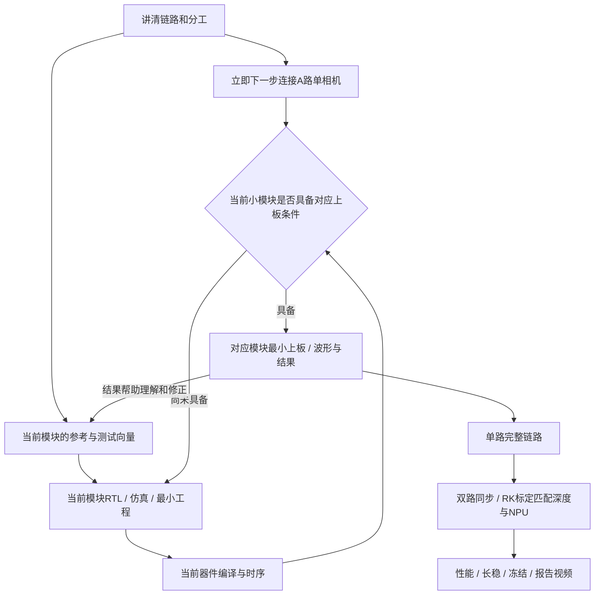

# 双目系统研发路线与每日安排 Implementation Plan

> **2026-10-10更新：PCIe用户报告连接成功。官方系列页/新发布报道存在硬D-PHY信息，撤回此前直接排除硬核的执行前提；同一官网PH1P100SBG484选型行仍列MIPI DPHY为“－”，具体封装适配属于资料冲突，优先核对硬D-PHY入口，HRIO转为备选。详情见`docs/进度与D-PHY纠正记录_2026-10-10.md`；不能写成当前板硬核已经编译/上板验证。**

> **当前用户阅读入口：** 先读`当前必读/01_FPGA主线学习手册_由浅入深.md`，再读`当前必读/02_FPGA独立开发路线与工作包.md`。后者细化了FPGA独立工作包F0—F10；本文保留整队日历。5份旧日程/草稿已归入待删除候选，D1/D2原文在`参考资料/历史实操/`保留。用户当前要求先阅读，本轮未实施RTL或上板。

> **For agentic workers:** 实施时使用 superpowers:executing-plans 按当日工作包推进。当前是用户要求的“大致研发路线与每日安排”，逐文件接口、测试命令与精确操作在对应工作包开始时展开；本轮不实施RTL或硬件测试。

> **当前执行优先级（同日再次调整）：** 用户要求直接推进FPGA相机，提供官方套餐/客服背书作为板级组合与连接使用依据；不先安排独立硬件排查，RK暂不作为依赖。已确认尚未连接，立即下一步为A路单CAM005连接，随后控制工程/读回→真实接收→本地正确图像。操作入口：`docs/相机主线_第一步连接与调试.md`。本条覆盖下方旧“先W0/W1再W2”及仅10-10才能开始的限制；日历不是启动许可或等待日期。

**Goal:** 在固定PH1P100、双CAM005和RK3588上逐步完成采集、硬件预处理/压缩、PCIe、标定/匹配/深度与NPU，并以实际证据提交作品。

**Architecture:** 用户已认可主传RAW12、FPGA三算法并行验证、优先评估分块无损LZ77、RK完成ISP/深度/NPU。用户最新确认采用“边理解边上手”：今天理解链路/边界，10-10起允许硬件连接与基础实操；每个模块按理解/参考→实现/仿真/编译→对应小范围上板循环推进，不等全部RTL结束才首次接板。D1/D2基本完成的实操作为基础，详见`docs/D1D2_既有实操基础与后续起点.md`。

**Tech Stack:** TD、Verilog、Python参考模型；RK侧Linux/ARM64、队友确认的OpenCV/RKNN版本。

**Spec:** `docs/双目首版_整链路方案与团队交付.md`，结合相机模式、接收复用报告及`当前必读/选题三_重新对齐后的方案基线.md`。原文和源码定位仍以这些证据报告为准。

## Global Constraints

- 日期按北京时间2026-10-09制定；2026-11-04提交，11-20至22决赛。
- 用户每天至少4小时，后期可增至6小时以上；10-31冻结、11-01至03材料/视频为目标保留窗口。
- 首个完整采集目标双路1920×1080、每路30fps；深度允许较低分辨率/fps，以实测确定。
- 标定、双目匹配、深度重建和NPU均保留；RK新增工作包尚需队友确认交付。
- 理解主线后即可连接并开始相机调试，不必等指定日期；已有D1/D2技能/成功例程沿用，不重新从安装/点灯开始。新bit按当前工程验证；仪器用于具体问题定位。
- PH1P HR接收、电气/同步、压缩率和C2H吞吐仍有待验证条件，用户认可架构不等于这些条件已通过。
- 禁止批量删除；保留用户及历史文件；当前非Git仓库，不自动建仓库/提交。
- 本计划只安排研发；没有生成完整工程、执行编译/下载、发送队友消息或创建自动提醒。

## Review Focus

- 模拟数据能通过而真实DT/WC/裁剪不同：W3使用可变包长/元数据向量，W9用实流复核，不能把合成图写成实拍。
- 坏包、溢出或丢FS造成左右错配：W3/W6测试整帧失效，W10验证配对失锁与重新建立对应关系。
- LZ77出现膨胀或搜索停顿：W1/W4测试RAW回退、最差周期和随机/噪声输入，不用zlib压缩率冒充本核结果。
- PCIe停顿、尾字节、掉线或DMA缓冲复用：W7先做激励/状态机验证，W9再做实际驱动/随机流与恢复。
- 标定后裁剪/方向/缩放或ISP改变：W10记录处理版本与K/D/R/T/Q，重新对应参数，不沿用不匹配标定。

---

## 1. 先理解整条路线

你每天只盯一个主工作包：理解输入输出，完成最小功能，查看验证结果，记录问题。助手支持原文核对、参考模型、RTL/仿真与报告检查；你负责必要的工具操作、实物操作和结果确认。队友独立推进RK的软件链，避免等待FPGA真实出图才开始。

既有基础直接沿用：会用TD/下载、ChipWatcher已抓波形、HDMI/DDR官方bit已成功、目录骨架已建。用户补充D1/D2基本完成；**PCIe于2026-10-10用户报告连接成功**。正式csi2.al、相机接收与帧DMA仍待开发。逐步推进是每个模块学一点、做一点、看结果再修正；不把基础课重讲一遍，也不以旧指南内容证明新模块通过。

## 2. 阶段、产物与前后依赖

| 阶段/目标窗口 | 做什么 | 看见什么才向下走 |
|---|---|---|
| A：10-09至12，相机控制与真实接收起步 | 连接A路单相机，建立控制工程/读回/启动，进入最小接收前端；RK与压缩模型不前置 | 实际ACK/读回、当前器件报告、真实接收活动及具体卡点 |
| B：10-13至18，分模块开发与验证 | 相机控制、PHY/CSI、压缩、三算法；各模块仿真/编译后安排相应上板 | 小模块功能/工具/实物证据分开记录；接收风险在此阶段开始暴露 |
| C：10-19至22，缓存/PCIe与集成 | DDR队列、C2H与帧协议；模型验证和对应板间验证，逐段贯通 | 正确数据、帧所有权、当前器件报告与实际传输证据 |
| D：10-23至26，单路闭环 | 已验模块组合，真实图处理/压缩/传输/解码；不是这天才首次接板 | 实际正确图、CRC/帧号/吞吐日志；单路实际解码/处理/压缩 |
| E：10-27至29，双目与整队 | 同步与配对、实拍标定/匹配/深度、NPU与性能 | 真实左右帧、深度/距离误差和NPU结果；实际fps/延迟 |
| F：10-30至31，可靠性与冻结 | 长稳/异常恢复、资源与量化、可恢复版本 | 可复现演示、原始日志、已实现与未达项明确 |
| G：11-01至04，提交 | 报告、视频、复核、提交 | 材料与实际版本一致；用户保存提交回执 |

这些是**目标窗口，不是每阶段必能按日完成的保证**。HR电气/路由、实流接收及PCIe吞吐须由对应工具/实测验证，早连接不等于这些条件已通过。若B/C未完成，D/E顺延并重新评估11-04能交付的范围。涉及改变既定功能/硬件的选择，呈现具体影响后一次确认一个重点。

## 3. 每个工作包负责什么

以下为正式工程`D:\TD\work\csi2`内的规划位置；没有因本表而创建文件。开始当日任务时先读已有文件，逐项确认精确文件/接口和测试命令。子系统分开验证，再集成，避免一次生成所有RTL。

| 包 | 工作边界/规划目录 | 输入→输出 | 当包的验证重点 |
|---|---|---|---|
| W0 | `docs/`接口、进度与交付表 | 已认可架构→双方能理解的格式/职责 | 原始/处理格式不混淆，队友同意与用户同意分开记录 |
| W1 | `model/` RAW/帧/压缩参考，`tb/`固定向量 | RAW样本/图集→packed数据/块流/解码样本 | 已知样本、round-trip、坏长度/截断/越界、膨胀回退 |
| W2 | `src/cam/` 控制状态机/模式表 | 连续控制时钟→复位/配置/I2C状态 | ACK/NACK/超时、24ms位置、成功读回条件，不把busy结束当成功 |
| W3 | `src/mipi/` PHY包装、对齐、包层、RAW解包；`tb/`包激励 | 合成lane/字节输入→有效RAW样本/帧诊断 | offset/deskew范围、ECC/CRC、EBD/OB、WC尾拍、丢帧/失步 |
| W4 | `src/codec/` 分块LZ77与字节打包 | 独立原始块→压缩或RAW块 | 字典重置/重叠匹配/末块、真实周期、输出上界，和W1逐字节对照 |
| W5 | `src/img/` 轻量去马赛克、灰度、高斯、前帧HE | RAW12像素→三分支Y8 | Bayer相位/边界/舍入、同bin冲突、LUT换帧与坏帧拒绝 |
| W6 | `src/mem/` DDR适配、帧槽/压缩槽、仲裁 | 有效像素帧/块→有所有权的帧队列 | 地址单位、满队列、最大停顿、发布顺序和在读槽不被覆盖 |
| W7 | `src/pcie/` BAR控制/C2H，队友RK驱动 | 帧/主机空闲DMA块→TLP/重组帧 | MPS/边界/尾字节、wait/credits、长度/CRC与复位恢复 |
| W8 | `csi2.al`、顶层/约束/IP（分阶段建立） | 每阶段小模块→当前器件最小工程；之后合为整链路 | 缺模块/原语、PAD时钟路线、CDC/STA、资源，不借旧板报告 |
| W9 | `debug/`、`docs/bringup.md`真实记录 | 已具备条件的实现→实际信号/帧/传输结果 | 当时核对供电/接线/仪器；启动、图像/CRC、带宽、恢复 |
| W10 | 队友RK软件，双方联调记录 | 有效左右帧→深度/点云/NPU | 真正对应帧、标定/单位/缩放版本、距离误差和实际速度 |
| W11 | 报告/视频/版本记录 | 实际日志/冻结版本→提交材料 | 宣称与证据一致、可恢复、回执 |

- [ ] 当前先走W9连接→W8/W2相机控制读回→W3真实接收→本地图像；W0/W1按实际接口需要补充，不作为这条主线的统一前置。
- [ ] W8最小工程随W2/W3/W7分别建立/编译，W6/W7功能验证成立后再做完整集成；不等所有模块写完才检查时序/布线。
- [ ] W9从下一步A路连接开始，与W2/W3调试直接相连；不专设仪器排查日，不重复已完成基础例程。
- [ ] W10的离线软件由队友提前准备，真实标定和整队验收等正确帧后进行。
- [ ] W11从第一天保留日志，但提交前集中整理材料。

## 4. 每天怎么做：4小时基本节奏

| 时间 | 你的操作 | 助手应提供的帮助 |
|---|---|---|
| 30分钟 | 读当日概念与输入输出，说明哪里不懂 | 只讲当日需要的内容，给对应原文/代码位置 |
| 120分钟 | 按步骤完成当日一个功能；必要时操作TD/运行脚本 | 逐文件、小范围代码/模型与操作说明；不一口气覆盖全工程 |
| 60分钟 | 跑当日相应的仿真/工具/上板验证，查看数据/波形/日志 | 检查结果与预期差异；上板只验证有明确功能和接线依据的小模块 |
| 30分钟 | 写下做了什么、结果、卡点、次日首步 | 更新进度和交接；按实际结果调整次日任务 |

后期有额外2小时，优先修复、回归与记录；暂不加入4K主线或第二种从零开发的压缩器。遇到问题保留完整日志；错误未关闭时次日接着处理，不为了赶表换下一项。

## 5. 提交前每日主任务

| 日期 | 当日主任务与步骤 | 当日产出/下一步条件 |
|---|---|---|
| 10-09 | 理解整条链路/分工；核对D1/D2已实操基础和新反馈 | 不从零重教；10-09时PCIe未测试，10-10已报告连接成功；此行为历史记录 |
| 10-10 | W9/W8/W2：接好A路单相机，随即建立相机控制最小工程，推进MCLK/复位/I2C读回；沿用TD/ChipWatcher基础 | 当日争取ACK及寄存器读回；未完成则下一次继续该具体卡点，无需等RK或独立仪器检查日 |
| 10-11 | W2/W3：完成读回，加入首版模式和正确启动等待；建立当前PH1P最小接收前端 | 相机开始输出，当前器件编译/PnR结果；用ChipWatcher观察控制与接收活动 |
| 10-12 | W3：实际单lane的采样、位序/字节边界、SOT；CSI包层用激励同步准备 | 从真实流看到可解释的字节/同步；失败即沿当前前端调试，不切去做无关软件 |
| 10-13 | W3：扩展四lane对齐、CSI头/DT/WC、CRC与RAW12解包 | 实流包/像素和错误统计；尽早暴露接收问题 |
| 10-14 | W3/W6：接入本地缓存/图像检查出口，争取第一张正确单路真实图 | 图像尺寸/方向/裁剪、稳定帧及错误统计；这是提前目标，不保证当天出图 |
| 10-15 | W1/W4：分块LZ77参考编码/解码、RAW回退和固定/重复/随机向量；规则验证后开始最小硬件块 | round-trip、最差长度与初步周期结果；接收未通时仍优先修复接收，**方案检查点1** |
| 10-16 | W3/W4：复核实际RAW帧完整性与坏帧行为，继续压缩RTL和解码对照 | 接收/压缩各自证据；按已完成结果调整后续集成 |
| 10-17 | W5：轻量去马赛克→灰度→高斯，先固定小图，再完整尺寸 | 像素参考与边界一致；未通过就继续本包 |
| 10-18 | W5：前帧HE、4bank统计、LUT换帧与三路选择 | 三算法仿真、坏帧不更新LUT；汇总未完成模块，**模块检查点2** |
| 10-19 | W6：DDR用户接口/地址单位、帧槽/仲裁模型；当前工程通过后验证实际帧数据读写 | 所有权/满队列/停顿与真实数据回读；不用重复官方bit代替帧缓存 |
| 10-20 | W7：沿用PCIe已连接成功基础，查看已有枚举结果并补BAR初验；C2H分块发送接TL激励，具备条件后试随机块 | 枚举/BAR、分块/尾字节/反压分别记录；RK等待时继续独立C2H模型 |
| 10-21 | W4/W6/W7集成：合成帧→压缩→缓存→发送模型→解码；核对持续周期 | 单路合成闭环，压缩/搬运吞吐差距；**软件闭环检查点3**，不成立则续做 |
| 10-22 | W8：合并已验最小工程/模块/IP/约束，做整链路编译/PnR/STA | 当前器件整链路报告与需修项；小模块此前已经按条件上板 |
| 10-23 | W9：整合此前控制/接收成果，复测单路图像入口到帧队列 | 真实帧/错误/队列记录；不是从头重新接线或首次测试 |
| 10-24 | W9：单路真实CSI→正确RAW帧；复核DT/WC/裁剪/第9帧后稳定性 | 实际图像、尺寸、CRC/fps/启停记录；失败就分层修复 |
| 10-25 | W9：在此前DDR/PCIe初验基础上测整帧连续搬运、停顿与恢复；未完成的前置先补齐 | 随机块/整帧CRC、持续有效带宽及恢复日志；不是重跑同一基础例程 |
| 10-26 | W9：单路完整处理/压缩/传输/RK解码，替换合成图集为真实图 | 实拍压缩比率/吞吐、单路NPU输入；**真实闭环检查点4**，未过不推进双路集成 |
| 10-27 | W10：双路接收/主从同步/帧配对；链路正确后采集实拍标定图 | 真实同步条件和配对记录、标定数据；不可用两张随意到达图冒充对应帧 |
| 10-28 | W10：队友用实拍图标定/校正/匹配/重建、距离验证，联调NPU | 参数/单位/版本、深度/点云/误差与NPU运行结果；深度可按许可降分辨率/fps |
| 10-29 | W9/W10：对比合法30fps配置，测双路与各段延迟/吞吐/资源 | 实际fps、错误/丢帧与性能瓶颈；没有达到的指标明确列差距 |
| 10-30 | W11：长稳、停止/重启/丢帧/掉线恢复；补量化表 | 原始连续运行日志与恢复结果；留出实际运行和失败重跑时间 |
| 10-31 | W11：冻结已验证版本，双方复现演示与备份，列未达项 | 可恢复源码/IP/约束/bit/模型及版本对应关系 |
| 11-01 | W11：写报告，原文/实现/量化/局限与分工对应 | 报告初稿、证据索引；缺证据补测，不补想象数字 |
| 11-02 | W11：拍摄真实完整链路、三算法、压缩/PCIe、深度与NPU | 视频和字幕与实际版本/速度一致 |
| 11-03 | W11：双方复核报告/视频/提交格式，演练恢复、备份 | 最终包与复核清单；以修复和材料为主 |
| 11-04 | 用户提交，并保存实际回执和版本 | 提交完成以平台回执为证据 |

同一天表中列出的多个子步骤属于同一个产出，不要求4小时从零完成整个复杂子系统。10-13至22是**连续开发窗口**：例如W3可能占多天，C2H/压缩可能需要追加迭代；日期只是检查点。若前置未完成，更新后续表，不把这些行当成工期估算证明。助手准备模型/代码也不消除用户理解、工具排错和真实联调的时间。

## 6. 现在与接下来三个工作包

### 今天10-09：理解主线后即可进入连接

- [ ] 在文档中找到主链：RAW12→DDR→LZ77→PCIe→RK；标出FPGA三算法分支与RK深度/NPU分支。
- [ ] 建立四个状态概念：“已读资料”“已完成软件/RTL”“已通过工具验证”“已实测”。没有证据就不勾后者。
- [ ] 理解控制、接收、缓存与RK各自作用后，按`docs/相机主线_第一步连接与调试.md`连接A路单相机；用户也可在下一次动手时执行，不必等全部计划或软件模型完成。

### 工作包1：连接后直接推进控制读回（目标10-10）

- [ ] 30分钟：断电接好FEP与A路排线，沿用1.8V设置和PC下载连接，说明控制/高速信号用途。
- [ ] 120分钟：建立当前器件最小相机控制工程，准备匹配模式的MCLK、复位/等待与I2C读回模块；检查并编译本包代码。
- [ ] 60分钟：具备可下载实现后，用ChipWatcher看状态/ACK/3000h及3002h读回。工程未完成就继续工程，不为时间表编造通过。
- [ ] 30分钟：记录结果及一个具体卡点。合计240分钟；可提前完成或延续到下一次，不专设供电/仪器排查日。

### 工作包2：启动相机并建立真实接收（目标10-11至13）

- [ ] 从已有骨架出发，检查现有源/约束，建立PH1P100SBG484、speed -3最小工程；不覆盖用户文件或重建所有目录。
- [ ] 只加入当前控制/时钟/复位所需模块，查看真实编译结果；新bit有明确功能和条件后才下载。
- [ ] 读回成立后加入594Mbps/27MHz/20fps/RAW12候选模式与启动流程，随后单lane→四lane→CSI/RAW12；直接结合实际流理解数据格式。

### 工作包3：先争取本地正确图像，再进入压缩（目标10-14至16）

- [ ] 优先将实际接收接入本地缓存/图像出口；无需RK即可检查首张正确图像。显示出口按可用实现选择，尚无当前项目HDMI集成成果。
- [ ] 随后读literal和distance/length；约定块边界、字典重置和RAW回退。
- [ ] 编码→解码→逐字节对照，测试重复、随机、末块与截断。
- [ ] 算包含块/帧头的实际长度；记录合成数据的局限。只有软件正确和吞吐预算明确后才进入W4，不急着做压缩上板。

## 7. 队友在同一期间做什么

责任是草案，须队友本人接受；本轮没有代发消息。

| 阶段 | 队友可独立做的软件工作 | 何时才需要真实硬件输入 |
|---|---|---|
| 设计/参考阶段 | 接口评审、RAW12/块/帧解码、固定ISP、模型输入约定 | 无需等待相机/PCIe出图 |
| RTL阶段 | 用离线左右图建立标定/校正/匹配/深度；核对RK软件/驱动构建依赖和DMA接口 | 离线图只证明软件流程，不证明当前相机深度效果 |
| 工程集成阶段 | 驱动参数/缓冲/错误处理、接收程序、与FPGA共享向量验证 | RK准备好后即可与FPGA对应最小工程初验PCIe，不必等全部图像RTL完成 |
| 实流联调阶段 | 实拍重新标定、真实NPU/深度、距离误差与速度 | 需要正确且对应的真实左右帧 |

建议你自行发给队友的一段话：

> 我们首版准备由FPGA传两路裁剪后的RAW12，先验证分块无损LZ77，经PCIe送到RK。RK侧需要接收/解码、去马赛克、彩色NPU，以及标定/校正/匹配/深度；深度先按实际性能定分辨率和帧率。你是否可以承接这组RK工作？我们确认责任后，再逐项约接口和交付日期。

## 8. 重排、提交后与下一步

- 检查点1：压缩封装/图集和比率口径；检查点2：RTL缺口；检查点3：软件闭环/工具实现；检查点4：真实单路闭环。每次用产出决定后续，而不是到日期自动通过。
- 最新要求是边理解边实操，10-10可开始连接/基础验证，取代前一条“先全部软件/RTL后上板”的顺序。电气/真实同步等仍以对应实测关闭；路线受阻时列具体失败点及变更成本，一次确认一个重点。
- 10-31后以稳定提交与材料为先；4K30/60fps保留为有余量后的提升项，不挤占11-01至03。
- 11-05至19按“缺陷复现/可靠性→PCIe与压缩瓶颈→深度/NPU→有余量才提分辨率/帧率→决赛演练”滚动优化；11-20至22按实际赛程。到11-05按提交结果重排该段每日任务，不现在假定提交时的缺口。
- 下一步已明确为连接A路单相机，随后立即推进最小控制工程和读回；RK和压缩模型不阻塞。以当前真实流问题为主线调试，不为日历换任务。

本路线按用户最新“边理解边上手、明天可以连接硬件”以及“D1/D2基本完成”的反馈修订；日历仍为滚动安排，不伪称所有旧验收或新工程已完成。
