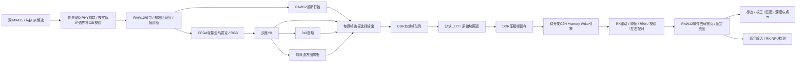

# 双目首版：整链路候选与团队交付

> **2026-10-16现行覆盖说明：** 下文是RAW12/LZ77时期的架构历史。当前RAW10 packed＋Bayer预测/Rice方向及资产复用，按[10-15研发策略](superpowers/plans/2026-10-15-fpga-remaining-strategy.md)与[10-16整合决策](DeepSeek独立检测与现行方案整合_2026-10-16.md)执行；三算法RAW10截高位为`>>2`，Bayer边界保持CFA奇偶。正式R10F/BPR1封装及拒收规则尚未共同冻结，不能照抄下方旧RAW12格式或旧压缩吞吐。

> **2026-10-10更新：PCIe用户报告连接成功。官方系列页/新发布报道存在硬D-PHY信息，撤回此前直接排除硬核的执行前提；同一官网PH1P100SBG484选型行仍列MIPI DPHY为“－”，具体封装适配属于资料冲突，优先核对硬D-PHY入口，HRIO转为备选。详情见`docs/进度与D-PHY纠正记录_2026-10-10.md`；不能写成当前板硬核已经编译/上板验证。**

> **后续最新状态（2026-10-09）：** 用户认可首版架构；最新反馈改为边理解边上手、明天可连接硬件，D1/D2基本完成作实操基础。当前路线见`当前必读/选题三_研发路线与每日安排.md`，各模块参考/仿真/编译后做对应小范围上板。架构认可不关闭具体参数/接口冻结、队友承诺或性能/电气验证；以下核验日期和证据边界保留。

> 2026-10-09，第三批第三小步。设计供审阅，尚未实施或冻结接口。依据相机及接收两份核验报告，以及本次定向读取的官方PCIe/DDR源码。没有新的综合、PnR、仿真或硬件结果。
> 用户新增确认：演示必须包含标定、双目匹配、深度重建；可以放在RK，需与队友确认交付。深度首版允许低于采集的1080p30，按实测定分辨率/帧率。允许先按“两路RAW12→RK去马赛克/灰度/深度/NPU”的接口出方案，仍需队友确认。

## 1. 首版范围与建议

固定F9P/PH1P100SBG484、VID006、双CAM005-IMX415、OrangePi 5 Max/RK3588，FPGA为PCIe EP，RK为RC。双路1920×1080每路30fps是首个完整采集里程碑；深度和NPU分别报告实际运行帧率。规则场景表的60fps仍是单独差距，不以30fps开发目标代替最终达标结论。

首版主通路建议传输**裁剪后的RAW12 packed**，不先传RGBX。RK恢复12bit样本，固定去马赛克/亮度映射，再供彩色NPU与灰度深度链路。FPGA另由RAW12产生RGB和灰度，灰度分叉到高斯、均衡；三种硬件算法同时运行，帧边界选择一个输出用于压缩/传输验证。默认RAW旁路用于标定与深度，防止左右独立均衡改变匹配输入。切换处理模式必须带mode_id，不能把不同模式的左右帧配对。

压缩推荐首先验证**分块无损LZ77候选（下文为自定义LZSS式封装）**。理由是能逐字节验证RAW与标定输入，不额外引入JPEG量化误差；代价是传感器噪声可能使压缩率很差，匹配搜索吞吐也尚未证明。共同图集和周期模型未通过前，不冻结压缩核或承诺节省30%。JPEG保留为替代路线，切换需要重新评估RAW→颜色转换、质量对匹配/NPU的影响和实现工期。

图中每个方框是工作项，不代表已存在可用模块。RAW模式是正常功能；未压缩模式只作为初验及块膨胀回退，不能据此称硬件压缩验收完成。

## 2. 各段数据约定、时钟与反压

除相机模式原文外，以下是待确认设计值。流接口均须valid独立于ready，停顿时data/keep及全部sideband保持稳定；只在valid且ready时推进。

| 段 | 建议格式/并行宽度 | 时钟与缓存 | 反压/失效处理 |
|---|---|---|---|
| 每lane采样→CSI包 | 每lane8bit；4lane合成32bit字节流 | 594档pclk74.25MHz；891档111.375MHz；各路独立接收域 | 相机不能暂停；入口满、失步或坏包使当前帧失效，到下个FS恢复 |
| 包→像素 | RAW12 3B→2样本；内部4×12bit=48bit，4bit样本有效掩码 | 跨拍残留、逐DT分流和记录区裁剪；不得混入EBD/OB/footer | CRC未结束前的数据为暂存，FE及整帧检查通过后才发布描述符 |
| RAW主路径 | 按行重打包：P0[11:4]、P1[11:4]、{P1[3:0],P0[3:0]} | 每行2880B，帧3,110,400B；FIFO跨到存储域 | 只收1920×1080记录区；固定Bayer相位，不把12bit容器当16bit传输 |
| FPGA处理路径 | 4pixel/拍；RAW12→RGB每分量12bit→固定截取高8bit→Y8 | 每路独立流水线，目标100MHz，须STA验证；3×3行缓存 | 独立于RAW主通路；选中输出发生溢出则标整帧无效，不静默跳像素 |
| 三算法 | Y8、Gaussian(Y8)、HE(Y8)三分支；每路4×8bit/拍 | 高斯两行缓存；均衡分bank直方图/双LUT | 全部分支计算，帧开始锁定选路；验证模式可逐帧轮换输出 |
| 帧存储 | 原始/处理帧统一128bit打包+byte keep | DDR用户域采用真实生成IP的dhi_clk；不猜具体频率 | 写入最高优先级并有有界服务保证；队列满丢整帧并计数 |
| 压缩 | 每块≤16KiB，独立字典；输出字节流/128bit打包 | 先单引擎验证，再双引擎；目标每引擎150MHz，尚未证明 | DDR吸收压缩停顿；实际最低输入吞吐决定是否加并行或调整路线 |
| PCIe | 256bit TL数据总线；帧可拆多TLP | 官方生成IP的tl_clk_user；手册范围20–125MHz，具体选项随速率/lane | 严格遵守tl_tx_wait/credits及报文边界；详细时序需UG1313/官方仿真补证 |
| RK | packed RAW12→uint16样本；软件明确RGB/BGR排列 | 队友确认内核/驱动/解码/ISP版本 | 驱动先验证长度/CRC/序号，再发布图像；超时/错误帧不进入深度 |

CSI RAW12打包约定实施前用独立标准向量和传感器输出核对；RK端帧载荷只包含记录区，不能直接把未裁剪的CSI负载当该格式。

## 3. 三种硬件预处理怎样落地

1. **灰度：** Bayer先按实际裁剪后的相位去马赛克，首版采用3×3双线性插值及复制边界，得到12bit RGB；首版固定映射为R8=R12>>4等，不先自动白平衡/伽马。Y8=(77R8+150G8+29B8+128)>>8。这是工程定义，不代表传感器每个12bit输出位都有12bitADC精度；也不冒充高质量ISP。
2. **高斯：** 对Y8做3×3权重[1 2 1;2 4 2;1 2 1]，(sum+8)>>4，复制图像边界、保持1920×1080尺寸；与均衡并行。不得靠舍弃边界变小图后继续填1080p标签。
3. **均衡：** 首版使用最近一个完整有效前帧的CDF-min LUT，当前帧一边统计一边查表，第一帧LUT为恒等。四像素并行时按lane分4个直方图bank，帧后合并，避免同灰度值的多次更新丢计数。22bit计数覆盖2,073,600像素。CDF-min分母为0时用恒等LUT；更新未完成则继续旧LUT并记录lut_source_seq。坏帧不发布新LUT。该结果不等于OpenCV对当前帧两遍equalizeHist，参考模型必须遵守前帧定义。

三算法验证包括静态图逐像素比对、边界、同bin连续输入、四lane同值、坏帧丢弃、模式切换与停顿。展示应给出三分支实际RTL/吞吐与输出；赛事是否要求三路同时传输仍待组织方口径，不能擅自解释为只需三选一实现。

FPGA与RK去马赛克不要求彼此逐像素一致，但标定和运行必须使用同一个RK处理版本、模式、裁剪、方向和亮度映射。首版校正前不做左右各自直方图均衡。

## 4. 压缩选择、封装与早期验证门槛

| 候选 | 优点 | 代价与证据边界 | 首版处理 |
|---|---|---|---|
| 分块LZ77/LZSS式无损编码 | 保留RAW；解码后可逐字节比对；块独立、错误容易隔离 | 没有本项目已验证RTL；低噪声/平坦图与自然RAW的比率不同；搜索带宽/资源需实证 | 推荐先验证；原始块回退避免数据膨胀淹没带宽 |
| JPEG | 可调量化，有现成软件解码工具 | 需要颜色/灰度输入与8×8缓存，通常有损；匹配/NPU影响和PH1P资源/许可未闭合 | 作为有期限备选，不与LZ77同时从零开发 |

本次限定目录检索未发现可据此冻结的LZ77/JPEG编码模块；文件名fpga_prj_compress.bit中的compress不能证明图像压缩。网上找到的[作者JPEG工程](https://github.com/kleinkuang/jpeg_encoder)使用Zynq演示及浮点算术，测试平台是115200串口；当前读取范围未得到适用许可和1080p30吞吐依据，不列为直接移植方案。

推荐封装候选：16KiB独立块，4KiB窗口，匹配长度3..18；每8个token有1B标志，literal为1B，match为12bit(distance-1)+4bit(length-3)共2B；允许重叠复制，解码按前向逐字节执行。每块16B头含格式版本、RAW/压缩标记、原长和实际负载长；不节省时存RAW块，字典下一块重置。具体magic和字段布局等双方确认后冻结，不把该自定义流声明为zlib/DEFLATE兼容。

全literal时临时编码区上界N+ceil(N/8)，16KiB为18KiB；有RAW回退后网络每块≤N+16B，不靠假定压缩率设计缓存。匹配查找先验证有限候选哈希法，不做无限链搜索；吞吐按真实周期统计，不能用接口1B/拍代替平均消耗1B/拍。

[RFC1951](https://datatracker.ietf.org/doc/html/rfc1951)定义的是LZ77与Huffman组合的DEFLATE格式。Python zlib结果只能作另一算法的对照，不能充当这里自定义封装的压缩率/硬件性能。

实施开始前段的共同验证工作包：

- 固定图集目录、清单、哈希；含自然纹理、低照噪声、标定板、平坦/渐变/重复纹理。无真实RAW时可以用合成Bayer作功能测试，但禁止当实拍压缩率；相机出图后替换为共同实拍左右帧。
- 软件参考先完整定义上述token、RAW回退、解码与坏流拒绝，逐字节round-trip；测试随机/全相同/最大距离/重叠匹配/末块/截断/越界。
- 同图集对比RAW12、Y8、高斯Y8、均衡Y8；记录原长、载荷长、含帧/块头总长、平均/最差节省比例、软件耗时、硬件周期模型。颜色/位宽转换节省不能算作压缩器节省。
- 最低持续输入目标为双路RAW12的186.624MB/s，设计门槛取25%余量，即233.28MB/s；硬件频率、BRAM端口冲突和下游停顿均纳入模型。达不到时先明确加并行成本，再决定调整压缩路线/工期。
- 若选定场景确有≥30%节省要求而共同图集不达标，不能写“达标”；列明差距，评估JPEG及对深度影响后由团队选择。不存在当前已测压缩率、实时吞吐或资源百分比。

## 5. 官方PCIe/DDR例程核验与搬运选择

来源P：`D:\TD\work\peripheral\12_pcie_gen2x2\`。
来源D：`D:\TD\work\peripheral\09_ddr3_ddrmc_cal_x32_1066mbps\`。

| 原文/代码定位 | 已核实的事实 | 首版含义 |
|---|---|---|
| P/prj/case_ep/ph1p_pcie_ep_top.al:9 | Device=PH1P100SBG484；工程另含旧绝对路径 | 当前器件参考，仍要在新工程修正源引用，不照搬历史build结论 |
| P/prj/case_ep/al_ip/ram/ram.v:23—28 | 256bit×128深度=4096B | 测试RAM不是帧缓存；BAR地址空间大小也不等于RAM实容量 |
| P/rtl/ep_side/pcie_ep_engine.v:195—225、280—314 | 接收IO/MEM事务、测试数据入RAM，MEM读地址截取7bit | 可参考TLP拆解/完成包；不等于任意DDR地址访问已经具备 |
| 同上:321—351、491—511 | 发送状态为IO完成/MEM读完成/MSI-X；4DW MWR仅发1DW MSI-X数据 | 未见帧描述符/连续C2H帧DMA引擎，必须另开发 |
| P/driver/ph1p_pcie_driver/anlogic_pcie_drv/cdev_ctrl.c:219—277 | BAR单字ioread32/iowrite32；bulk循环按i>>2移动地址 | bulk路径需修正单位与边界；不能拿函数名bulk推断吞吐或正确性 |
| 同文件:225、254、268 | 范围校验只是注释 | 队友适配驱动需实际验证bar_id/offset/length/alignment及数组界限 |
| 同文件:281—288 | 配置ioctl直接解引用用户传入arg | 不能原样当作可交付驱动；改为受检copy_from/to_user并验证权限/参数 |
| P/driver/ph1p_pcie_driver/anlogic_pcie_drv/anlogic_pci_drv.c:7—17、50—58 | 驱动头声明GPLv2；设备匹配1edb:abcd | 保留适用许可；实际枚举ID取当前IP/硬件结果，不写成已发现设备 |
| D/prj_src/rtl/top/ddrmc_test_top.v:56—58、109—162、168—212 | DX_NUM=4对应256bit数据，控制器连接ph1p_ddrmc_mtest测试发生器 | DDR控制器可作基线；帧仲裁/分配/真实数据接口尚未实现，不能把PAXI猜成完整AXI4 |
| IPUG028_1.1物理p42/印刷38，物理p51/印刷47 | tl_clk_user选项20–125MHz、TL发送总线256bit；详细信号指向UG1313 | TL包装和官方激励需核验；本地Doc文件名检索未找到UG1313，不编造wait/valid精确时序 |

bulk问题的直接例子：offaddr=0时循环i=0,1,2,3分别访问字节偏移0,0,0,0，i=4访问偏移1；同时使用wdata[i]。它没有按32bit元素连续访问0,4,8,12。具体bar_len应是字节还是元素要统一后修正，而非只改一处移位。

数据路线分两级：

1. **初验：** BAR寄存器+小测试RAM回读，固定图/单帧分块慢速传输，验证端序、长度、CRC、分块和驱动。此级不承诺双路实时。
2. **整链路候选：** BAR控制，FPGA作为requester发送C2H Memory Write到RK驱动分配的DMA缓冲；一次提交一个连续DMA块，按协商MPS、4KiB边界和有效尾字节分TLP。以小块复用，避免要求几MiB连续物理内存或首版引入完整SG链读取。驱动提交下一个空闲块并消费完成块；同一帧可跨多个DMA块。先轮询，MSI优化后置。

RK必须使用Linux DMA API返回的dma_addr_t，不将用户指针/CPU物理地址硬填到FPGA；coherent缓冲也需要正确的发布/消费屏障。依据[Linux DMA指南](https://docs.kernel.org/core-api/dma-api-howto.html)。候选从64KiB DMA块池开始，实际池大小由队友内核/CMA与吞吐实验确认，失败可缩小块；块间握手开销计入实测。只有数据与完成元数据的顺序、link reset、超时和buffer生命周期验证后才可连续运行。FPGA尚无该C2H实现，队友尚未承诺驱动交付。

## 6. DDR队列与帧协议草案

DDR建议先预留32MiB地址区（容量/地址单位及可访问范围在当前控制器初验时核对）：每相机3个4MiB原始/处理帧槽，共24MiB；2个4MiB压缩暂存槽，共8MiB。单路槽状态FREE→WRITING→READY→ENCODING→FREE；压缩槽FREE→ENCODING→READY→SENDING→FREE。发布前检查整帧尺寸/CRC，写失败回FREE但增加错误记录。DMA不结束不得复用发送槽；三帧槽只吸收有界暂停，不能消除持续吞吐不足。

满队列时丢新到的完整帧并记录frame_seq缺口，不覆盖RK/压缩正在读取的槽；左右配对只接受同一次采集会话和共同同步序号。若模组共享同步最终不成立，只能报告异步采集/配对效果，不能宣称真实同步或稳定动态深度。

capture_seq按每路识别到的FS推进，包括随后失效/丢弃的帧，不能只数成功出图。两路本地计数相等本身不证明是对应帧：启动时要在已验证同步下建立序号偏置与配对锁定，并记录共同时间基SOF差值；若丢FS/复位导致序号对应关系不确定，则撤销配对锁定、停止深度发布，重新联合启动/建立对应关系。短包Frame Number原始值单独保存，在验证其真实递增行为前不当作可靠全局帧号。

建议帧头固定128B、字段小端、保留字段清零；以下字段是必需项，精确偏移在双方评审后冻结：magic/version/header_bytes、session_id、camera_id、capture_seq、mode_id、format_id、width/height/stride、Bayer相位/方向/裁剪、raw_bytes、payload_bytes、block_count、SOF时间戳及频率、曝光/增益参数版本、错误flags、raw_crc32/payload_crc32、header_crc32。

建议CRC32采用明确定义的IEEE反射形式（0xEDB88320，init/final xor=0xffffffff，check字符串123456789为0xcbf43926），只用于帧完整性；与CSI CRC16的协议校验分开。坏帧不能以CRC重算后伪装有效。帧号与时间戳不等于曝光同步证据。

BAR控制项至少包含：版本/功能、启动/停止/session、相机状态与mode、全部接收/溢出/丢帧计数、DMA目标地址高低/容量/块cookie、提交/忙/完成/实际字节/错误；只接收空闲状态下、容量合法的新提交。RK按frame_id+chunk_offset+chunk_len+last_chunk重组帧；超时丢整帧，不把重复块拼成新帧。

## 7. 吞吐、缓存与资源预算

全部是按1920×1080×30计算的**需求值或设计额度**；MB为十进制，MiB/KiB为二进制。不是测量值。

| 每路记录区格式 | B/帧 | 双路30fps有效数据 |
|---|---:|---:|
| RAW12 packed | 3,110,400 | 186.624 MB/s |
| RAW16容器 | 4,147,200 | 248.832 MB/s |
| GRAY8 | 2,073,600 | 124.416 MB/s |
| RGB888 | 6,220,800 | 373.248 MB/s |
| RGBX8888 | 8,294,400 | 497.664 MB/s |

RAW12每帧190块，RAW回退含块头最多3,113,440B，另加128B帧头=3,113,568B；双路30fps最多186.81408MB/s（尚未含DMA块元数据/TLP）。PCIe有效载荷持续目标至少约233.52MB/s，另留块协议开销；不能从Gen2x2理论值推导实测达标。错误/掉速后重算目标。

DDR主路径负载为：相机写R、压缩读R、压缩暂存写S、PCIe读S，即2R+2S；按上述RAW回退上界约746.88MB/s，25%余量约933.60MB/s。诊断额外RAW保留、同时写三种处理图或重复读均需另加，不包含在该主路径预算。首版仅写一个选中输出，减少无必要的整帧副本。

DS1300_1.2.1物理p11/印刷5表1-1：PH1P100为129024 LUT4、143360 DFF、300个ERAM20K（合计6000Kbit）、220 DSP、12 PLL。表格已渲染核对。以下是**预留额度/停止扩张门槛**，不是综合预测：

| 项 | 首版预留/估算方法 |
|---|---|
| 双路RAW入口FIFO | 每路32KiB，合计64KiB；深度应按最大不可服务时间与实测突发率复核 |
| 去马赛克/高斯行缓存 | 每路RAW两行≈5.6KiB，高斯Y两行3.75KiB；双路基础≈18.75KiB，另计边界/打包 |
| 双路HE | 每路2组×4bank×256×22bit≈5.5KiB，双LUT另0.5KiB；合计约12KiB |
| 双压缩引擎 | 每引擎窗口4KiB、哈希约8KiB、输入16KiB、临时输出18KiB，基础约46KiB；合计约92KiB，端口复制另计 |
| 其他FIFO/TLP/诊断 | 预留64KiB，若不足先据报告调整 |
| 片上存储小计 | 上述逻辑容量约251KiB，ERAM形状/双口/位宽浪费未计；按实际300块中的≤210块作为初步总额度 |
| LUT/DSP/PLL | 全工程初步额度≤90000 LUT4、≤110 DSP；27MHz相机INCK、每路IOCLK/LCLK、DDR/PCIe与处理控制时钟逐项登记，PLL总数不得超12 |

三行算法通常无需大量通用乘法器；这些额度不是使用量保证。未来每次综合看模块占用，每次PnR看实际时钟/球位与STA，资源余量不等于高频可布通。

## 8. RK深度、NPU与队友交付表

RK参考流程：RAW解码→固定ISP/灰度→stereoCalibrate/stereoRectify→remap→StereoBM或StereoSGBM→reprojectImageTo3D。依据[OpenCV官方calib3d文档](https://docs.opencv.org/4.13.0/d9/d0c/group__calib3d.html)，这是跨平台软件接口参考，不是RK3588速度测试。SGBM/BM定点视差用于3D重投影时须按文档处理1/16比例；无效/负视差屏蔽，不输出伪距离。

深度首版可从640×360、5fps工程试验点开始，**不是用户承诺或RK性能证据**。标定需实测标定板格长、固定双目支架/基线和镜头；记录K/D/R/T/Q、单位、有效ROI、重投影误差及校正后对应点纵向误差。降采样后重新对应内参/投影/Q，不只缩图而沿用原Q。用有真实距离的近/中/远目标记录误差、有效深度比例、fps和处理耗时，点云与伪彩深度至少给出一种可解释展示。

| 工作包 | 拟责任方 | 交付和验收 | 状态 |
|---|---|---|---|
| RK基础环境/RC枚举 | 队友 | 板型/系统/内核/架构/头文件；实际lspci -nn/-vv、dmesg、链路速率/lane | 尚未收到实测 |
| BAR驱动与C2H缓冲 | 队友；FPGA配合 | ARM64原生构建、边界检查、DMA块池/地址/所有权、复位超时、随机数据CRC和持续吞吐 | 待队友确认责任/日期 |
| 帧解码与ISP | 队友；助手提供参考 | packed RAW12/块格式解析、round-trip向量、端序/相位/裁剪、RGB/BGR与灰度转换版本 | 用户允许按此出方案，未获队友承诺 |
| 标定/校正/匹配/深度 | 队友主实现；用户配合采集/测量 | 标定参数/格长/基线/误差；实际匹配参数、深度/点云、距离误差及性能日志 | 用户同意放RK；交付待队友确认 |
| NPU | 队友 | 明确模型与RKNN工具/运行时版本，彩色输入格式/缩放/归一化；实际NPU推理与效果/耗时 | 模型、版本、输入尚未冻结 |
| FPGA采集/处理/压缩/DDR/PCIe | 用户主责；助手支持 | 源版本、仿真/综合/PnR/STA、寄存器读回、帧/错误统计与实测 | 尚未实现整链路 |
| 整队验收 | 双方 | 同步测量对象、压缩率分母、各段延迟、连续运行、视频/报告 | 需按实际结果交付 |

队友应先独立用离线左右图完成标定/匹配/深度与模型链，不等待PCIe出图。给队友的内容是交付草案，不代替本人确认；本轮没有向队友发送消息。

## 9. 实施退出门槛（架构已认可，具体顺序按新路线）

以下G0—G7是所需证据的分类。按用户最新要求，今天理解链路，明天可沿用已有基础连接/核对硬件；各模块参考/仿真/编译与对应小范围上板交替，详细时间以新路线为准，不重复已完成基础例程。

- [ ] **G0：团队接口与环境。** 队友确认RAW/ISP、深度、NPU、驱动交付；确认万用表/示波器与探头条件、BANK13电压和共享同步线。不能用电脑文件权限代替实物检查。
- [ ] **G1：压缩/包/处理的软件与仿真基线。** 固定共同向量、块协议/帧协议、RAW12与三算法参考；压缩周期/比率决定是否继续LZ77。重点测试边界和坏流，禁止用zlib结果替代候选。
- [ ] **G2：低速控制及PHY可行性。** 单路27MHz/594档、I2C ACK/读回、明确24ms等待；先电气、映射/PnR/STA与训练窗口，再四lane完整包。电气不闭合不得把成功采样当兼容证明。
- [ ] **G3：单路真实帧。** 第9帧以后DT/WC/CRC/尺寸/fps/启停正确；隔离EBD/OB与裁剪，用RAW旁路看真实图。失败时继续独立PCIe/压缩工作，登记阻塞。
- [ ] **G4：DDR与PCIe独立。** DDR真实帧模式与随机流压力；RK枚举/BAR后，C2H分块传固定/随机数据，证明持续有效吞吐及复位恢复。不得跳过接收busy/错误状态。
- [ ] **G5：三算法与压缩单路闭环。** 逐像素/字节对照、坏帧与满队列恢复、压缩吞吐和比率；RK实际解码/NPU。再比较594档30fps推导候选与891档表列30fps。
- [ ] **G6：双路同步与深度。** 模组同步连接/共享波形、对应行/帧的测量；相同模式/曝光，配对丢帧不串对；RK实拍重新标定、匹配与距离误差验收。
- [ ] **G7：冻结与证据。** 长稳、掉线/停钟恢复、全部量化数据、视频/材料；明确60fps/4K等尚未达到部分。

任何门槛失败，都不能用到期日期“判通过”。关键PHY与PCIe/压缩是三条独立风险，应尽早并行暴露；用户本人每天仍按一个主任务执行。当前只完成设计与资料核验，不提前创建完整ROM、主工程、IP或下载。

## 10. 原文路径及剩余待补

- 相机与接收：`docs/IMX415_首版模式与寄存器差异.md`、`docs/PH1P100_接收模块复用核验.md`所列Sony及本地源码定位。
- PCIe：上文P路径中的.al、pcie_ep_engine.v、ram.v、cdev_ctrl.c/h及anlogic_pci_drv.c；本轮对关键实现直接读取，驱动完整生命周期仍需队友适配时审查。
- DDR：上文D路径中的ddrmc_test_top.v；ddrmc控制器生成参数、PAXI详细握手/地址单位/仲裁、板上实装容量及可访问范围在实施前核对，不将官方bit成功写成帧缓存可用。
- PCIe手册：`D:\downlaod\Doc\IPUG\IPUG028_PH1P_PCIExpress_IP_Guide.pdf`；详细UG1313本地文件名检索未找到，作为TLP引擎实施前资料缺口。
- 资源：`D:\TD\03_F9P_CA05_PH1P50_PH1P100\V2026\HW-MLK-F9P-CA05-PH1P100\02_hardware\HW-MLK-F9P-CA05-PH1P100\HW-MLK-F9P-CA05-安路-20260525\06_芯片手册\01_FPGA\安路\DS1300_PH1P_Datasheet_1.2.1.pdf`物理p11表1-1。
- 正式工程的`D:\TD\work\csi2\docs\interface_v1.md`仍是旧草案，其RAW10/LZ77/中断/ID等不因本报告自动冻结；本轮未改写D盘工程。

剩余人类确认包括队友的交付承诺/模型、仪器具体能力与最终应用/规则解释。它们不需要重做七轮问答；逐项在对应阶段确认。架构已获认可，研发/每日顺序以当前新路线为准，边理解边做对应实操，不继续无限搜集资料来填实测空白。
