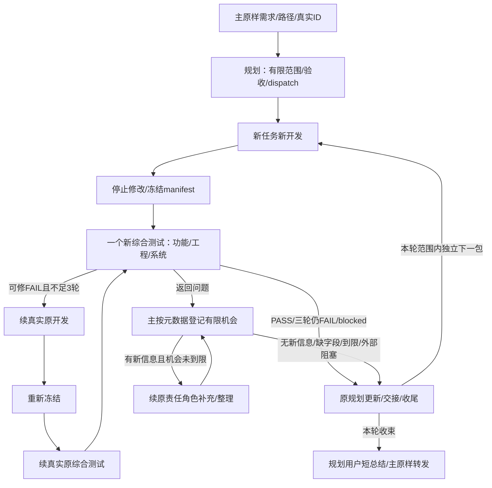

# FPGA 多智能体工作流：主对话仅作传输

2026-10-17现行规则。保留主传输/规划/开发分工，按用户新要求改为一个综合测试者、有限拆分、主不监控和有限返回机会。根[AGENTS.md](../AGENTS.md)是项目入口；统一有界正文见[工作范围、停止与有限返回机会](../.agents/skills/fpga-orchestrator/references/work-limits.md)。

## 以后怎么用

本项目复用现有fpga-orchestrator Skill作为唯一入口，关闭隐式调用，无需安装MCP或修改全局配置。需要启动时明确输入：

Codex：

> $fpga-orchestrator 执行：<本轮明确需求>

> $fpga-orchestrator 恢复：<原run绝对路径>；本轮目标：<目标>

从技能选择器显式选择后明确要求执行/恢复也有效。例如：

> $fpga-orchestrator 执行：核对T03的R10F与BPR1接入合同，本轮交一份字段表、样例及验收清单，不做硬件下载。

> $fpga-orchestrator 恢复：<原run绝对路径>；本轮目标：完成该run原授权的剩余配置。原ID可续则续，实际失效由规划按文件恢复并登记真实映射。

OpenCode 2.0.28：在本项目目录打开OpenCode，使用能写调度文件的主会话（例如Build），输入：

```text
/fpga-orchestrator 执行：<本轮明确需求>
/fpga-orchestrator 恢复：<原run绝对路径>；本轮目标：<目标>
```

也可明确要求“使用 fpga-orchestrator skill 执行/恢复”。`.opencode/opencode.json`只把技能源指向原`.agents/skills`，命令及三个子角色入口引用同一份技能，不复制工作流正文。OpenCode以`opencode/autoinvoke: "false"`保持显式触发；Codex的openai.yaml保持原设置。角色链、任务上限、一个综合测试者和全部停止/修复/返回计数不变。实际调用见[宿主适配](../.agents/skills/fpga-orchestrator/references/runtime-calls.md)与[OpenCode调用](../.agents/skills/fpga-orchestrator/references/opencode-calls.md)。2.0.28用独立command文件提供斜杠入口，不依赖新版文档的opencode/slash元数据；不安装MCP、不改全局配置。

普通问答、报错解释、资料讨论、仅提技能名、引用/代码例子/转述、解释/查看/比较/修改规则都不启动本链；技能选择后仅要求讨论也不算执行。根项目通用约束及其他适用技能/工具照常。已启动同一run继续已授权范围，中途问状态/规则不另开新链；明确停止/退出时停止派发并留下恢复入口，当前配置无需重新触发。

Codex端agents/openai.yaml只设policy.allow_implicit_invocation: false，保留显式使用。项目Skill保存规则与启动约定，足以覆盖本需求；MCP连接真实工具/其他系统信息，当前无需实现或安装服务器。依据：[OpenAI Skill文档](https://learn.chatgpt.com/docs/build-skills)、[OpenAI MCP文档](https://learn.chatgpt.com/docs/extend/mcp?surface=cli)。OpenCode端加载以当前版本接口核实；已打开客户端若入口未刷新可重新打开本项目，不对其他正在运行的会话做全局reload。加载检查、普通聊天行为及完整角色链分别记录，不外推验证结论。

明确启用后主先读[fpga-orchestrator](../.agents/skills/fpga-orchestrator/SKILL.md)，原样保存需求/路径并派规划。已经派出的子角色直接读指定角色技能，不回主入口、不再派生。历史配置验证见[旧验证记录](FPGA多智能体工作流_验证记录_2026-10-16.md)，只代表当时版本；旧三测试记录不能当新规则的行为证据。本次配置只验证G0合同/G1静态一致性，不代表完整调度、RTL、时序或板测完成。

## 固定责任链

**主原样传输 → 原规划理解/有限拆分/dispatch → 每任务新开发 → 停止修改并冻结唯一manifest → 一个新综合测试者 → 同任务FAIL续原开发/综合测试，最多三轮实际修复 → 原规划更新/收尾 → 主原样转发。**

| 角色/技能 | 职责 |
|---|---|
| [主传输](../.agents/skills/fpga-orchestrator/SKILL.md) | 原样需求/路径/真实ID/判定/状态，机械日志和固定分支，保留权限/路径检查 |
| [规划](../.agents/skills/fpga-planner/SKILL.md) | 读相关材料、理解/有限拆分、依赖/范围/验收/G层、dispatch、任务更新和收尾 |
| [设计规范](../.agents/skills/fpga-design-guide/SKILL.md) | 规划/开发按需冻结接口/参数/时序/证据；不新增常驻角色 |
| [开发](../.agents/skills/fpga-dev/SKILL.md) | 允许范围实现、必要局部检查、冻结、停止修改、修复与lessons |
| [综合测试](../.agents/skills/fpga-tester/SKILL.md) | 与开发独立，统一完成相关功能/工程/系统检查，依次独立审阅和最终工程复核 |

三个旧领域技能保留为历史兼容与按需检查参考：[功能](../.agents/skills/fpga-tester-functional/SKILL.md)、[工程](../.agents/skills/fpga-tester-engineering/SKILL.md)、[系统](../.agents/skills/fpga-tester-system/SKILL.md)。其旧调度、另两维并行、分维报告和独立角色续接语句不生效，不默认派发，不要求每次全读三份。

主不理解技术需求、选题/设计/拆分/排依赖，不读原材料/完整计划/源码/报告，不开发/测试/判断根因或影响/写技术总结。详细材料交对应角色，主只收简短dispatch和返回元数据；用户反馈保持原话。

## 拆得细，也限定本轮规模

默认一次需求本轮1个主要可验收目标、最多4个正式工作包（ready/blocked/依赖均计入），只有需求→工作包两级。每包一个主要可观察结果，通常一个模块、接口或文档主题及必要相邻引用，最多5项语义实现步骤；两个独立结果、无关接口或第6项语义步骤触发拆窄。读取/哈希/跑命令/同步多份引用等机械动作不另建包或代理。

超限时原规划首次计划只取依赖闭合最小切片（<=4包），依用户明确优先级、已有依赖顺序、需求出现顺序取舍。余项最多3条后续主题加原需求路径，不展开树、不自动续做。无法成小闭环只交1个范围/接口冻结包，不能冒充父目标完成。

只有用户明确本轮新的有限目标数/任务数/层数才可由规划在dispatch记覆盖值和授权来源；“全部做完”、合批、时间宽裕不算。不能用增大BATCH_SIZE、新run、自造子ID或重命名失败包绕限。默认批大小1，用户明确大于1才定义批；每批一开发、一综合测试覆盖全批，任务总数不因合批减少。

## 一个测试者，保留必要验收

functional、engineering、system是同一综合测试者的检查清单。规划事先选适用项/G层/阈值与不适用理由；测试者独立于开发，不声称三个独立视角，不额外派审阅Agent。

文档/配置检查语义、格式/入口/哈希及交接兼容；模型/软件检查相关正反向、边界、可复现性和接口；RTL/时钟/IP/存储/地址/板上行为保留所需真实DUT、最终STA/CDC/资源/候选绑定以及必要真实硬件、恢复、稳定性和性能检查。风险增加先加检查或缩小包，不自动加角色；缺必需条件为FAIL+blocked，不临时改不适用求PASS。

最小相关上下文、按需引用旧领域清单、一次必要构建及有依据的同输入证据复用减少重复；不能节约门槛，不承诺token百分比。开发自检不代替独立综合验收，软件/离线包PASS不将父硬件任务置done。

## 主不监控，子角色自行停止

主只接收返回事件/完成消息及明确元数据，不轮询状态、不扫描目录或日志、不问进度/催促。Codex的wait_agent单次<=60000ms只等事件；OpenCode默认前台subagent等最终返回，不另造等待/轮询。等待无返回不产生检查、故障、催促或重试。真实ID来自当前宿主工具返回，跨宿主/OpenCode换父会话或实际工具报失效交原规划按文件恢复并登记新旧ID/宿主映射，不重置计数；失联无返回不伪造blocked/PASS，不称平台自动终止。

子角色每次派发/续接默认最多30次实际工具调用，规划15分钟、开发/综合测试45分钟；自己的命令轮询/worker调用计入。单问题最多3轮有目标搜索/读取；同失败命令首次+1次有新证据或参数纠正的重试。连续2次无新证据/产物/有效验证/假设收窄即主动blocked；达到预算或需扩范围也停止，不等主催促。

命令启动前落实实际deadline或安全终止：读取/搜索60秒、局部静态/仿真5分钟、构建30分钟；yield_time_ms不是执行超时。无法安全控制则不启动无界命令，返回TOOL_CONTROL_MISSING。只停止自己拥有的进程，保留实际日志/退出信息。规划可派发前冻结其他有限执行预算及理由，角色不自行扩。

缺资料/工具/设备/授权/额度直接blocked，DeepSeek/API错误不自动重试。不新增监控Agent、定时任务或常驻执行器。这是角色合同，不是平台硬限或失联自动停止保证。

## 重复问题最多2次补充机会

只在收到返回时，按task_id+稳定problem_id记账。problem须含reason_code、new_information布尔、evidence_path、requested_action、resume_input_path；固定枚举及身份约定见统一有界正文。

字段齐备、有真实新信息、证据/恢复路径齐备且是原授权范围补充/整理，最多2次续原责任角色（Codex用followup_task，OpenCode用subagent携带原sessionID）。无新信息、缺字段/矛盾、无法稳定归类或2次后仍同问题，直接交原规划blocked/备条件；转交/换措辞/改轮次不能重置。工具/设备/资料/权限/API/额度等外部阻塞直接备条件，不走机会循环。到限后仅真实新用户输入或条件变化可由原规划明确恢复。

补充机会与实际修复分账：round0首次验收，round1—3最多三轮实际实现修复；不能把修复改名为“回答机会”。主只检查元数据，不解技术题或监控兜底。

## 派发、判定与收尾

开发停止修改、活动结束并冻结后，dispatch的spawn_single_tester只新建一个原生综合测试子会话，传同一manifest和计划路径。Codex用spawn_agent且fork_turns="none"，OpenCode用subagent且省sessionID。每任务每轮一份integrated报告，首行唯一PASS/FAIL；回dimension=integrated、dimension_results、总体判定、报告/manifest路径、blocked和retest。



同任务FAIL续真实原开发/原综合测试，失败/受影响项复测，未影响证据由综合测试者明确绑定新manifest。输入漂移重新冻结，不拼不同输入PASS。缺条件直接交原规划，不空转三轮；三轮后仍FAIL保留⚠未通过，必要FPGA门槛不能强行通过。

固定分支见[传输合同](../.agents/skills/fpga-orchestrator/references/relay-contract.md)，调用模板按[宿主适配](../.agents/skills/fpga-orchestrator/references/runtime-calls.md)只选当前环境，报告见[综合报告约定](../.agents/skills/fpga-orchestrator/references/report-contract.md)。Codex的collaboration直接调用，不放functions.exec；OpenCode用真实subagent，新建省sessionID、续接带原sessionID，不套用Codex/旧OpenCode工具参数。

## 文件与恢复入口

真实开工时按需创建，不预建任务树：

```text
workflow/runs/<run_id>/
  request.md                 主原样需求
  main-log.md                主机械日志、真实ID、判定、问题机会计数
  dispatch.json              原规划下一动作/范围/有限预算
  input-index.md             原规划相关输入索引
  dev-plan.md                原规划有限工作包/验收
  fpga-design-guide.md        原规划冻结接口/参数
  candidate-manifest.json    开发唯一冻结输入/SHA
  candidate.diff             本包差异
  dev-notes.md                开发局部检查/边界
  lessons-learned.md          开发经验
  test-reports/
    <task_id>-r0-integrated.md
    <task_id>-r1-integrated.md
  handoff.md                 原规划恢复入口
  final-summary.md           原规划详细收尾
  user-summary.md            原规划用户文本，主原样转发
```

原规划读三维结果/综合报告/轮数，更新允许的任务记录与dispatch，统计首次/修复1/2/3轮通过、⚠未过、待条件；主只原样转发。任务状态与G层分账，workflow/tasks.json及证据/交接保持主源，run不另立全局任务板。

同任务原ID在当前宿主/父会话能续则续；跨宿主/OpenCode换父会话或实际失效交规划按文件恢复并登记真实新旧ID/宿主映射，不假称resume、不重置已用计数。没有多agent工具如实blocked，主不接管、不自动重试。OpenCode兼容仅增加项目内入口/角色薄配置与宿主调用参考，同步共用入口说明；不改任务板、其他worktree、生产/位流、全局skills或配置，旧三tester不删除。流程不扩大删除、外部写入、下载/Flash、发布、自动监控或队友消息授权。
