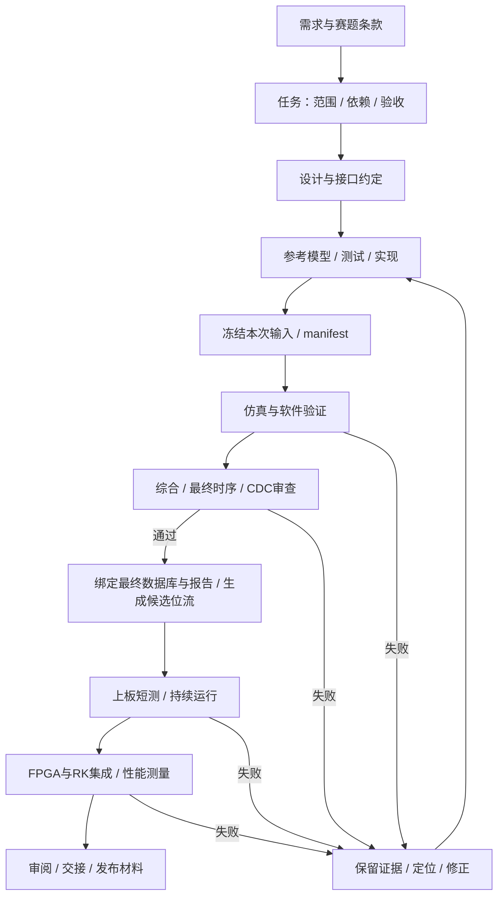

> **2026-10-15最新：** 140836实时图正常，但严重玫红，颜色G3失败。修复CWC物理ERAM映射后，用户已成功读取白/红/蓝三组统计。T01 awaiting_hardware，当前白平衡候选为`camera_rgb565_wb_20261015_002820`，220项冻结输入，GBRG相位3、R/B增益2400/2062（Q10）、标称黑电平50。实际候选绑定算术/流水/完整尺寸G1与所选G2通过，bit/CWC及161份证据已归档，修正颜色G3/G4未测；亮点暂缓。详细记录见[白平衡闭环](../docs/RGB565白平衡闭环_2026-10-14.md)。以下原版本记录保留历史范围，不覆盖此摘要。

第一轮固定白平衡233658的G2最终STA失败（setup−1.849ns/TNS−24.474ns），无bit。当前002820在乘积后寄存一级，并将显示帧信号与下游帧裁决同延后一拍，原始统计时序保持；14场景逐拍/打包器测试通过。失败报告与所有旧版本保留，见[白平衡闭环](../docs/RGB565白平衡闭环_2026-10-14.md)。

# 项目工作流：工程全流程 + AI 协作

> **2026-10-16默认调度更新：** 后续用户任务按[FPGA多智能体工作流](FPGA多智能体工作流_使用说明.md)与根[AGENTS.md](../AGENTS.md)执行：主智能体只调度，规划/开发/三维测试由对应Codex子智能体完成；本文件的G层与工程验收标准继续保留。

> **交付标准：** 用户要求每次交付前执行本文件第5.1节。通过门槛以当前候选证据为准，不能沿用旧位流板测结论。

版本：1.3，2026-10-15。适用 PH1P100 + 双 IMX415 + PCIe + RK3588 竞赛项目。

这套工作流把需求、任务、源码、测试、位流、上板观察、团队接口和提交材料串起来。当前交付为可立即人工使用的流程、模板、初始任务数据与工具接入约定；自动调度器、CI runner、工具插件和硬件下载没有在本轮安装或启用。

## 先从这里开始

1. 阅读[当前项目状态](../README.md)及[当前方案基线](../当前必读/选题三_重新对齐后的方案基线.md)，辨别最新结论与历史记录。
2. 在[任务路线与初始任务板](任务路线.md)中选一个没有未满足依赖的工作包；机器可读数据为 [tasks.json](tasks.json)。
3. 用[任务模板](templates/task.md)写清目标、修改范围、验收和停止条件。小任务只填必要字段。
4. 按下图推进；每次结束用[交接模板](templates/handoff.md)留下可继续的入口。
5. 接入 AI、团队工具或自动化前，读[AI 协作与工具接入](AI协作与工具接入.md)及[接入路线](接入路线.md)。

已经用现有资料填好一份 [T02 任务](records/T02/task.md)和[交接](records/T02/handoff.md)，可直接参考。其顶部记录最新的 222159 部分板验状态，下方保留 10-12 初始化历史；旧候选“尚未板测”的描述不能覆盖后续用户观察。

图中是完整硬件功能的路径。每次验证前冻结实际输入与 manifest；输入变化后建立新 run，旧结果只对应旧输入。资料核验、文档修订和纯 RK 软件任务只走相关阶段，不要求无关的 FPGA 综合或下载。并行工作必须有独立输入；涉及同一顶层、约束、DDR 仲裁和帧协议的修改顺序集成。

## 1. 我们要完成什么

主目标：在固定硬件上完成双目采集、FPGA 三种预处理与压缩、DDR 缓存、PCIe 图像传输，以及 RK 标定/校正/匹配/深度和 NPU 展示。

首个整链路目标是双路 1920×1080、每路 30 fps；深度与 NPU 各自报告实测分辨率、帧率和延迟。4K 为后续实测升级方向。30 fps 研发目标不能替代赛题最终验收口径，规则差距统一记录到[赛题验收矩阵](../docs/赛题条款与验收矩阵.md)。

当前主线RAW10单A4K30，经960×540 RGB565和外部DDR放大至1080p60；002820有220冻结输入，实测校色算术/流水/完整尺寸G1和所选G2通过，bit/CWC及161份证据已归档，颜色G3/G4待验，T01 awaiting_hardware。原140836颜色G3失败，统计读回G3通过。B断开、RAW12封存、30Hz停止；活动亮点暂缓。最新入口见[白平衡操作步骤](../docs/RGB565白平衡闭环_2026-10-14.md)及[T01交接](records/T01/handoff.md)。原回退和各次反馈保留各自边界，整机任务不标done。

## 2. 文件各管什么

| 内容 | 权威位置 | 维护方式 |
|---|---|---|
| 当前执行状态 | 根 README + 当前方案基线的最新摘要 | 已有结果发生变化时同步摘要，旧证据不改写 |
| 赛题条款与最终验收 | `docs/赛题条款与验收矩阵.md` | 条款引用带来源；研发目标与规则要求分列 |
| 任务优先级、依赖和状态 | `workflow/tasks.json` | 同一任务只保留一个 ID；Issue/看板是同步视图 |
| 任务具体约定 | `workflow/records/<task-id>/task.md` | 从模板建立；该目录在实际开工时创建 |
| 设计/接口/决策 | 现有 `specs/`、`docs/` 或任务记录 | 新文件引用既有文件，不复制出另一份冲突协议 |
| 运行证据索引 | 现有 `docs/evidence/` | 原始日志可在外部；索引保存准确路径与哈希 |
| 源码和构建入口 | `fpga/csi2/`、`tools/td/` | 仓库与 D 盘活动工程先比较哈希再同步 |
| 会话交接 | 任务 handoff + `CODEX_HANDOFF.md` 索引 | 简要写结论、证据、下一步，详细内容用链接 |
| 开源调研与来源 | [GitHub 调研](../docs/GitHub强相关项目调研与借鉴建议_2026-10-12.md) | 使用代码时固定 commit、文件和许可 |

`workflow/records/` 是今后记录的约定，不预建一堆空任务目录。`tasks.json` 初始状态仅为 2026-10-12 快照；开工前重新核对根 README，发现更新则先同步任务板。历史文档的旧 RAW12/PHY 描述不能覆盖最新基线。

## 3. 任务怎么推进

任务状态为 `backlog → ready → active → review → done`，另有 `awaiting_hardware` 与 `blocked`。状态描述的是工作安排，验证结果单独记，不能把“写完代码”当成“上板通过”。

| 状态 | 进入条件 | 离开条件 |
|---|---|---|
| backlog | 已识别需求，依赖或范围未准备好 | 目标、依赖、输入、验收可检查 |
| ready | 前置满足，拥有可开始的独立工作包 | 明确执行者并开始 |
| active | 正在设计、实现或验证 | 产生可审阅交付，或明确阻塞 |
| review | 交付物、证据、未测边界齐备 | 审阅通过；有问题则回 active |
| awaiting_hardware | 软件/构建工作已到可做板测的边界 | 实际硬件观察到达，继续验证 |
| blocked | 缺资料、设备、接口承诺或权限，无法继续该任务 | 缺失项补齐；不能伪造结果 |
| done | 本任务预先约定的退出条件全部满足 | 新问题重开；任务完成不外推为整机完成 |

每个执行者同时保持一个 active 工作包；主线问题未闭环时，不在同一硬件候选中堆叠多项功能。其他人可独立推进参考模型、RK 离线样例和协议测试。

Ready 最小条件：明确问题、输入版本、修改路径、输出物、相关测试、未知项、回退办法。Done 最小条件：结果符合任务范围，证据可复查，接口变更已交接，已知问题与未测范围已写明。无需每项小改动都写完整长文或新增测试。

## 4. 六层验证各自作结论

借鉴 OpenTitan 将设计与验证进展分开跟踪的思想，按我们的板级研发定义以下层级，**不沿用其芯片签核标准或覆盖率数字**。[参考](https://opentitan.org/book/doc/project_governance/development_stages.html)

| 层级 | 检查什么 | 通过所需证据 |
|---|---|---|
| G0 任务/接口 | 格式、单位、边界、预算、双方责任 | 可检查验收项；跨 FPGA/RK 接口有双方确认记录 |
| G1 模型/仿真/软件 | 数据内容、边界、恢复与反压 | 对应输入版本、日志、结果标记；关键缺陷有能拒绝旧行为的用例 |
| G2 构建/实现 | 综合、最终 STA、约束覆盖、CDC/复位、资源 | 同一最终数据库的报告；未约束路径与豁免说明；选定 CDC 审查范围 |
| G3 上板功能 | 候选实际下载、真实数据和恢复 | 位流 SHA256、连接/电源/运行参数、观察来源及错误计数 |
| G4 长稳/性能 | 持续运行、吞吐、丢帧、温度/热态相关观察 | 预先规定时长/负载/阈值，起止计数、原始结果；测量仪器和方法 |
| G5 集成/发布 | FPGA→RK→算法与可恢复交付 | 接口版本、端到端数据一致性、性能、材料和回退清单 |

每项验证结果只能用 `pass / fail / not_run / blocked / not_applicable`。不适用须给理由；blocked 须写缺失条件。需要的层级由任务范围决定。已有通过证据引用原记录及范围，标明不是本轮重新运行。

重要边界：仿真不是板测；综合不是最终时序；选定 CDC 检查不是全芯片 CDC 证明；DDR CRC32 不是 CSI 校验；帧号配对不是曝光同步；HDMI Hz 不是相机 fps；PCIe link 不是 DMA；压缩率不是输入吞吐。

长稳时长采用任务中事先约定的值，可按 10 分钟排查、30 分钟阶段检查、2 小时集成长测逐步加压。这些是建议测试档位，未替代赛题条款，也不代表当前已经通过。所有性能阈值写明负载、分辨率、格式、观测窗口和允许误差。

## 5. 每次验证绑定到什么

每次运行建立唯一 `run_id`，例如 `20261012_210000_T02_packet_a1b2`，记录：

- Git commit、dirty 状态、实际参与输入的文件清单及 SHA256，包括约束、生成 IP、ROM、测试和构建脚本。
- 仓库路径、D 盘实际候选路径、顶层、参数、工具版本、完整命令与实际工作目录。
- 预期结果类型、真实退出码、通过/失败标记和原始日志；退出码 0 本身不足以判断 TD 成功。
- 最终实现数据库/报告与位流哈希；输入发生变化，旧构建结果只对旧输入成立。
- 板测时记录下载的那个位流、会话、电源是否连续、连接、真实观察者和计数。

预期失败测试的“测试有效”与“DUT 功能通过”分开写。例如旧实现触发预期拒绝，可以证明测试有效，不能记成旧 DUT pass。缺日志、未确认源码或哈希不一致时，不提升任务验证状态。

Hog 值得借鉴的是源码、构建输入与位流的追溯方法；本轮没有引入 Hog，也没有证明其可直接支持 TD。[参考](https://github.com/Hog-CERN/Hog)

### 5.1 每次候选交付前的必检项

用户于2026-10-14明确要求将本工作流作为标准。助手交付新源码或上板候选前必须复核适用项目，并把结果写入本次证据索引；无关项目注明不适用及理由，不虚填通过。

1. 冻结实际构建输入、约束、ROM、IP、脚本及参数，保存manifest与SHA256；仿真绑定实际候选文件和参数，说明缩小几何模型的边界。
2. 行为修复有能拒绝旧行为的负对照及正向回归；复用旧证据须证明相关输入未变，明确不是本轮重跑。
3. TD原生命令须同时满足退出码、完成标记、非空产物；保留失败和超时记录，不用exit0代替成功判断。
4. 使用同一最终实现数据库检查STA、约束覆盖、所选CDC/复位、资源与必要接口路径；绑定数据库、报告及位流哈希。HDMI并行STA不能证明串行电气资格。
5. 含ChipWatcher的候选须运行`tools/td/check_chipwatcher_readback.py`校验完整CWC与BID的物理ERAM覆盖，确认配对bit逐字节一致；仅有探针名单不足以交付可读回调试文件。
6. 完成独立审阅后，由工程测试智能体复查最终实际文件、测试结果和哈希，并按同一冻结输入出具判定；主调度只核对各维度判定及报告入口，不亲自开发或跑测试。审阅未完成须如实标明，不宣称已审阅。
7. 给用户唯一当前位流/CWC入口、操作与预期现象、已知问题和回退版本。G3/G4待测明确写出；仿真及构建通过不表示颜色或长稳已上板通过。
8. 大改或累计多轮小改后，按用户授权将本任务源码、详细说明与精简证据同步私有GitHub。只提交本任务文件，不上传图片、凭据、数据库或巨大中间产物。

## 6. 日常节奏与故障处理

建议每天 4 小时按“10 分钟核对现状 → 20 分钟任务/验收 → 约 2 小时实现或测量 → 约 50 分钟验证 → 20 分钟证据与交接”分配；板测窗口到来时可调整。每天只承诺一个可验收的小闭环。

出现故障：先保存当次输入和日志，写预期/实际、复现条件、首次异常位置；一次只改变一个可解释变量。连续上电现象不得靠断电恢复后宣称修复。重复失败两轮后重审假设和观测点，避免继续盲目改参数。缺硬件时推进模型或 RK 离线工作，当前板测状态保持 not_run/awaiting_hardware。

每次结束留下：本轮改了什么、证据在哪、哪些仍未测、下一条可执行步骤、回退候选、需要队友交付什么。周度复盘只看三件事：关键路径、未满足验收、最贵的不确定性。

## 7. Git 与提交方式

采用短分支、小范围提交的 GitHub flow 思路；分支默认 `codex/<task-id>-<topic>`，工作树已有修改时先识别归属，提交只加入本任务文件。[参考](https://docs.github.com/en/get-started/using-github/github-flow)

提交/PR 描述说明问题、最终行为、相关验证和局限。PR 可以合入一个明确标注板测待验的功能模块，但不能据此把硬件任务置 done；可板测候选与稳定发布版本分开记录。发布 manifest 必须绑定验证过的输入与位流，不能重建后沿用旧板测结论。

禁止批量删除文件或目录，也不得用循环/脚本包装批量删除；删除只针对单个明确路径，批量清理由用户手动完成。禁止自动 reset/clean、覆盖独立修改、擅自改变权限或把源码同步当普通复制。外部 D 盘写入仍遵守当前会话的原生权限，流程文档不授予额外访问权。

## 8. 什么时候算整个项目可以交付

所有必选赛题条款都有对应实现、演示和证据；双路同步证据、三算法、压缩、PCIe 收帧、标定/匹配/深度、NPU 各自注明实际状态。端到端报告同时给采集、传输、深度、NPU 的指标。资料包括接口版本、依赖版本、构建/运行步骤、位流/模型哈希、视频、已知问题、回退与备份。

用户此前确认的提交日期为 2026-11-04，决赛为 11-20 至 22；以项目记录为准，本轮未核验外部赛程。优先冻结一个可演示、可恢复的已验证版本，优化使用独立候选。具体节奏见[任务路线](任务路线.md)。

## 配套文件

- [任务路线](任务路线.md)、[初始任务数据](tasks.json)
- [AI 协作与工具接入](AI协作与工具接入.md)、[接入路线](接入路线.md)、[工具配置草案](integrations.example.json)
- [IC Coder：1000 Credits / 30 天使用方案](ICCoder有限额度使用方案.md)、[首个只读审阅任务](requests/IC-001-guarded-pack-review.md)
- [任务](templates/task.md)、[设计/决策](templates/design-decision.md)、[接口](templates/interface.md)
- [验证](templates/verification.md)、[上板](templates/board-run.md)、[交接](templates/handoff.md)、[发布](templates/release.md)
- [可选 AGENTS 接入片段](AGENTS接入片段.md)

模板中的待填写字段是真实使用前需要补齐的信息，不是已经确认的项目参数。
