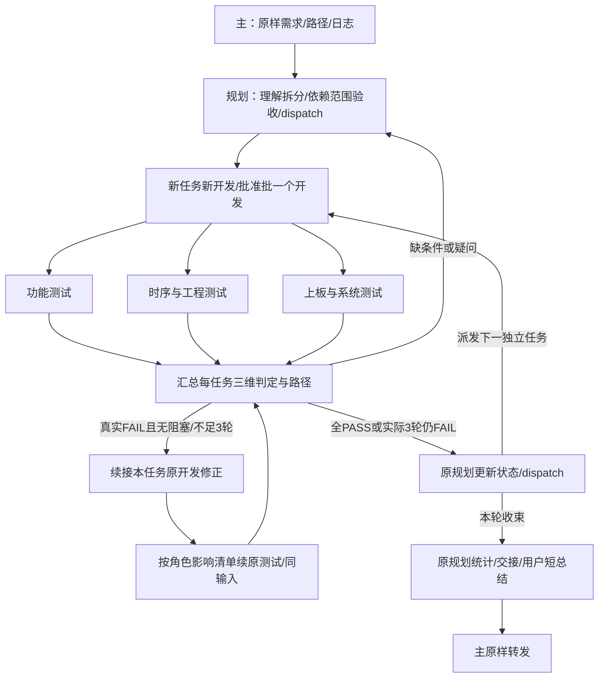

# FPGA 多智能体工作流：主对话仅作传输

2026-10-16。沿用截图原主体及项目配套技能，按用户明确批准的完整《主对话仅作传输》模板同步默认入口。本轮不重新研究原图、不重设计流程，不运行旧试任务或完整工作流。

## 以后怎么用

已将默认入口写入根[AGENTS.md](../AGENTS.md)。以后在这个项目直接布置任务即可，例如：

> 继续T10的行级压缩组合，复用现有BPR1软件和已有RTL，按默认工作流逐项验收。本次不改DDR/IP候选。

> 核对T03的R10F与BPR1接入合同，交付双方可用的字段表、样例和验收清单，不做硬件下载。

> 继续上次run，把原dev-plan、main-log、冻结manifest和失败报告路径交规划者恢复；同任务能续原开发/测试则续接，失效时登记新旧映射。

无需每次指定代理个数或粘贴长提示词。主提示词就是[fpga-orchestrator/SKILL.md](../.agents/skills/fpga-orchestrator/SKILL.md)，可以直接检查完整正文；显式调用名为`$fpga-orchestrator`。项目`.agents/skills`是Codex支持的本地技能位置，变更未出现在选择器时可重启Codex；当前会话也可按准确文件路径读取。[官方技能说明](https://learn.chatgpt.com/docs/build-skills)

本次交付配置与技能，不因编写流程而下载FPGA、运行TD、修改RTL或自动推进其他聊天。也没有建立无人值守的定时执行器。

此前配置校验、原代理续接与角色情境复核见[历史验证记录](FPGA多智能体工作流_验证记录_2026-10-16.md)，只代表当时版本。本次批准同步的范围为G0配置合同/G1静态一致性，详见[本轮计划](runs/20261016_185549_approved_workflow_default/dev-plan.md)；没有实际创建新聊天或运行完整流程，旧记录不能充当新配置行为验证。

## 原主体逐项保留

| 截图原结构 | 本项目保留/适配 |
|---|---|
| 主Agent只调度，不开发/测试/视觉验证 | 主Codex只原样转发用户原话、路径、真实ID、判定、状态和机械日志；技术理解/拆分/依赖/验收/总结归角色 |
| 原素材只传路径，不读大段内容 | 需求/赛题/工程材料由规划者读取，主调度只传路径 |
| 只收路径、ID和PASS/FAIL | 保留；增加必要的待硬件/阻塞元数据，真实G层结果仍在报告 |
| 初始化OUTPUT_DIR、SCRIPT_FILE、BATCH_SIZE，默认1 | 原变量保留；默认每任务新DEV/三TEST，用户明确大于1才由规划定义批 |
| main-log.md、dev-plan.md、设计指南、lessons-learned.md | 名称与分工保留；设计指南改为fpga-design-guide.md |
| Phase1规划，生成计划/规范/公共页面框架 | 规划理解需求并拆分、定顺序/范围/验收，写详细计划/指南/索引和简短dispatch；主不读完整计划或选任务 |
| 每批仅一个开发Agent，按顺序完成 | 完整保留；页面换为可验收FPGA工作包 |
| 布局/美观/动画三个测试Agent并行，各测本批全部页面 | 数量与调度保留，改为功能/工程/系统三个维度 |
| 第一时间记开发和测试ID，同批修复resume原Agent | 保留；直接记Codex工具返回ID，用followup_task续接 |
| 最多三轮修正、失败维度原测试者重测本批 | round0首次验收，最多三轮实际修复；开发/测试给复测影响，主不判断；缺外部条件直接交原规划，不空转 |
| 全PASS为✅，第三轮仍FAIL为⚠，继续下一批 | 分支/循环保留；FPGA的⚠明确为未通过，依赖任务等待，独立任务继续 |
| 每批状态更新、反馈，最后通过轮数统计 | 原规划更新任务/dispatch并写交接、技术和用户短总结，主原样转发；不虚报硬件验收 |
| yyMMdd HHmm日志，精确到分钟 | 格式保留，采用Asia/Shanghai |

只有“第三轮失败也低质量通过”不能成为FPGA功能、时序或安全的通过结论；它在相同流程节点保留为警告/未通过。没有改成主助手包办或换另一种协作架构。



## 配套技能逐一替换

| 截图角色/技能 | 本项目Codex技能 | 实际职责 |
|---|---|---|
| 主智能体提示词 | [fpga-orchestrator](../.agents/skills/fpga-orchestrator/SKILL.md) | 原样传输、真实ID/判定留档和固定分支，保留权限/路径检查 |
| dg-planner | [fpga-planner](../.agents/skills/fpga-planner/SKILL.md) | 理解拆分、依赖顺序、范围验收、dispatch、任务更新和收尾 |
| dg-gray-slide-designer | [fpga-design-guide](../.agents/skills/fpga-design-guide/SKILL.md) | 像素/码流/握手/队列/时钟及证据约定，不新增常驻角色 |
| dg-slide-dev | [fpga-dev](../.agents/skills/fpga-dev/SKILL.md) | 实现/局部检查/冻结输入、按报告修正 |
| dg-slide-tester-layout | [fpga-tester-functional](../.agents/skills/fpga-tester-functional/SKILL.md) | 数据、协议、算法、边界与故障拒绝 |
| dg-slide-tester-beauty | [fpga-tester-engineering](../.agents/skills/fpga-tester-engineering/SKILL.md) | 工程、最终STA/CDC、资源、bit/CWC与输入绑定 |
| dg-slide-tester-animation | [fpga-tester-system](../.agents/skills/fpga-tester-system/SKILL.md) | FPGA/RK接口、上板、恢复、长稳与整链路指标 |

子角色技能由主按真实绝对路径传给对应代理，不虚构`subagent_type`。使用`fork_turns="none"`传技能/输入路径，真实返回ID即时登记，collaboration直接调用，不放functions.exec。模板见[Codex调用对照](../.agents/skills/fpga-orchestrator/references/codex-calls.md)，简短dispatch/返回与分支见[传输合同](../.agents/skills/fpga-orchestrator/references/relay-contract.md)，报告见[报告约定](../.agents/skills/fpga-orchestrator/references/report-contract.md)。send_message只送消息，空闲角色新轮用followup_task。

原`Agent/resume/TaskOutput/Grep`的调用语法和`.claude`缓存扫描均已换为当前实际工具；保留其调度含义。[官方多智能体说明](https://developers.openai.com/api/docs/guides/responses-multi-agent)

## 本项目具体从哪里接

沿用`workflow/tasks.json`的T01—T14，F工作包只作现行策略映射。规划者每次核对[项目入口](../.agents/skills/fpga-orchestrator/references/project-context.md)，不能把本说明的配置日期当最新进度。

当前复用方向包括BPR1软件/局部RTL、parallel共享向量/算法参考、固定块/TLP和RK离线工具；DDR1333生成入口与颜色板验保持原边界。真实RAW、压缩行组合/回退/CRC、三算法真实DUT、PCIe硬核适配与实收各自形成小工作包。已有他人工作树成果先读验收记录，不能只看当前分支就重复建设。

本次不改任务板状态、不合并另一工作树、不换位流、不改全局skills或Codex配置；只同步项目入口、角色技能/引用和说明。既有`.gitignore`的七技能精确白名单保持原状。规划者按当前任务相关范围读材料，配置包不用生产源码、TD或板测凑流程。

## 每次任务产生的文件

```text
workflow/runs/<run_id>/
  request.md                   主原样保存的需求，附件只记路径
  main-log.md                  主的机械阶段、真实ID、判定与时间
  dispatch.json                原规划的下一动作/路径/范围/状态
  input-index.md               规划者的需求/来源/已有成果索引
  dev-plan.md                  规划的工作包/依赖/验收，主不读完整正文
  fpga-design-guide.md         本次采用的工程接口与设计约定
  lessons-learned.md           开发者的修正经验；首次需要时创建
  candidate-manifest.json      开发冻结同一实际输入与SHA，停止修改
  handoff.md                   原规划的恢复入口/未测边界
  final-summary.md             原规划的详细收尾
  user-summary.md              原规划的用户短总结，主原样转发
  test-reports/
    <task_id>-r0-functional.md
    <task_id>-r0-engineering.md
    <task_id>-r0-system.md
    ...                        每轮新报告，旧失败证据保留
```

这些目录在真实任务开工时创建，没有预建大量空任务。输入/DB/bit等原始证据继续引用现有`docs/evidence`或隔离工程，不搬运大文件来凑数量。

原规划读取矩阵/报告路径/轮数收尾，给首次通过、修正1/2/3轮通过、⚠未通过、待条件统计和下一入口；开发写lessons，主原样转发短总结。run控制文件不替代全局任务板。软件子包只完成自己范围，父任务板验/双路/整机不会自动完成。

## 效率与恢复

- 默认每任务新DEV与新三TEST，仅同任务FAIL续原角色；用户明确批大小大于1才由规划定义批。三测试同manifest并行，开发/测试提供复测影响，主不拼不同输入PASS。
- 主只收简短元数据，完整材料/计划/报告交角色；缺输入或状态矛盾交原角色，范围/验收归规划、复现/报告归测试、实现归开发。用户反馈原话传输，无效或过长返回由原角色整理。
- 一项失败不堵住所有无依赖工作；共享顶层/约束/队列/帧合同仍按依赖顺序集成。
- 缺设备/工具/资料/用户输入或额度直接blocked交原规划备条件，主原样转用户，不空转三轮。三轮后FAIL保留⚠，下一独立任务由原规划派发。
- 同任务同会话优先原ID续接；跨会话代理失效交规划者按文件恢复，登记新旧映射，不假称resume。所有子角色禁止递归派生。
- 本流程不会扩展删除、下载、发布或外部消息权限；缺少多智能体工具时报告不能运行当前架构，保留计划，不偷偷改成主助手亲自开发。
